# v9 architecture

The technical contract of the rewrite that ships as release 9.0.0. It binds every file under the new directories listed in "Repo map". The directories of the current app (`apps/web`, `apps/server`, `packages/db`, `packages/shared`, `fpp-analytics`) are v1: they stay in production until the cutover and take fixes only. For v1 the root `AGENTS.md` governs; for v9 this file governs, `UX.md` says what the product does and `ENGINEERING.md` how code is written, checked and run. Why each choice was made, and what was rejected: `STRATEGY.md`. Evidence: `research/`.

## Invariants

These cannot be retrofitted. A change to one is a plan change with the owner's verdict, never a side effect of a row.

1. **One origin.** Marketing pages, the room app, the API and the WebSocket are served under `https://free-planning-poker.com`. Storage is per origin, so a second origin would split settings, seat tokens and the service worker.
2. **Room URLs are `/room/<slug>`**, as in v1. Shared links and bookmarks keep working without a redirect.
3. **The server is the only writer of room state.** Clients send commands; one pure reducer on the server decides.
4. **A vote value leaves the server only after the reveal**, and before it only to the seat that cast it. This holds for every message, snapshot, log line, span and analytics event. One function builds each seat's view; nothing writes to a socket around it.
5. **A seat is proven by a server-minted secret**, scoped to one room. No global user id exists: the product cannot recognise a person across rooms.
6. **Every server event carries the room's `seq`**; every command carries a client message id. Reconnect is "send my last `seq`, receive a snapshot".
7. **The protocol version is negotiated at connect.** Changes are additive; clients ignore unknown fields and event types. A breaking change raises the version and old clients are told to reload.
8. **Durable state and ephemeral events are separate classes.** Reactions and typing-like signals are never stored and never get a `seq`.
9. **The reducer is pure.** Time, randomness and ids come in through its context argument. Nothing in `packages/room-core` reads a clock, a socket or the network.
10. **No script in the browser reads the device for measurement.** Analytics are sent by the servers from request data. Nothing is stored on the device that the user did not ask for.
11. **Telemetry carries no vote value, display name or room slug.** A room appears as its numeric id; a seat as its index.
12. **One process owns a room at a time**, enforced by an epoch column in Postgres, not by routing.

## Topology

| Path | Served by | Notes |
|-|-|-|
| `/`, `/guide`, `/analytics`, `/roadmap`, `/contact`, `/imprint`, new content pages | Cloudflare Worker with static assets (`apps/site`) | Astro static output. The Worker runs first for HTML documents only, to record the page view server-side. |
| `/room`, `/room/<slug>` | `apps/api` on the VPS | Returns the SPA shell. Hashed assets under `/_room/*`. |
| `/api/*` | `apps/api` | HTTP API, and the WebSocket at `/api/ws`. |

The split is made at the Cloudflare edge: a Worker route on `/*`, and narrower routes with no Worker for `/room*`, `/_room/*` and `/api/*` that fall through to the tunnel and Traefik. This is proven on the beta host before anything depends on it (stage 3, row `v9-edge-routing` in `PLAN.md`); the fallback is the Worker proxying those paths with `fetch`, which also carries WebSocket upgrades. Until cutover the whole of v9 runs on `https://next.free-planning-poker.com` with `X-Robots-Tag: noindex`.

The API container serves the SPA it was built with, so client and server ship as one image and one version. The same image with a Postgres container is the self-hosting story and the system under test in E2E.

## Repo map

Eight modules. The dependency arrows only point down this table.

| Path | Package | Holds | May import |
|-|-|-|-|
| `apps/site` | `@fpp/site` | Astro marketing site, content collections, the landing demo island, Worker entry for page-view recording | `@fpp/table`, `@fpp/room-core`, `@fpp/telemetry` |
| `apps/room` | `@fpp/room` | Vite SPA: routes, room shell, settings, insights, PWA, embed mode | `@fpp/table`, `@fpp/room-client`, `@fpp/room-core`, `@fpp/telemetry` |
| `apps/api` | `@fpp/api` | Elysia HTTP API, WebSocket room server, Postgres access, jobs, static serving of the SPA | `@fpp/room-core`, `@fpp/telemetry` |
| `packages/table` | `@fpp/table` | The game surface as React components: seats, cards, reveal, results, motion, sound. Takes a room view and callbacks; knows no transport | `@fpp/room-core` (types) |
| `packages/room-client` | `@fpp/room-client` | Headless client: connection state machine, pending commands, resume, storage of seat tokens. No React, no DOM beyond `WebSocket` and storage ports | `@fpp/room-core` |
| `packages/room-core` | `@fpp/room-core` | Protocol schemas and types, the reducer, the per-seat projection, decks, the room runtime (handshake, seat tokens, resume, presence, limits) behind ports, and the deterministic simulator with bots (`@fpp/room-core/sim`) | nothing in the workspace |
| `packages/telemetry` | `@fpp/telemetry` | Attribute, event and metric names; the `recordError` and `recordEvent` facades for server and browser | nothing in the workspace |
| `e2e` | `@fpp/e2e` | Playwright suite and fixtures against the built image | none at runtime |

Database access lives in `apps/api/src/db` and is not a package: only the API touches Postgres. `@fpp/room-core` is the deep module of the system; every other module is an adapter around it.

## Stack

Versions as read on 2026-11-18; a row that installs one checks it with `agw web package` and pins it exactly.

| Concern | Choice | Version line |
|-|-|-|
| Runtime, package manager, unit test runner | Bun | 1.4.x, one exact pin for local, CI and image |
| HTTP and WebSocket server | Elysia with Eden Treaty for the typed HTTP client | 1.4.x exact; 2.0 is a release candidate and is adopted in its own row after it is stable |
| Validation | Zod 4 for protocol frames in `packages/room-core`, Elysia's `t` for HTTP routes. The SPA imports protocol types only and ships no validator | Zod 4.x |
| Database | PostgreSQL on the shared VPS instance, schema `fpp` | 18 |
| ORM and migrations | Drizzle | 0.45.x; the 1.0 line is a release candidate |
| Room app | React with the React Compiler, Vite, TanStack Router (file routes, client only) | React 19.3, Vite 8, Router 1.170 |
| Design system | basalt-ui, profile `app` in `apps/room`, profile `tokens` in `apps/site` | 3.x, see "basalt-ui" |
| Marketing site | Astro, static output, MDX content collections | 7.4 |
| PWA | vite-plugin-pwa, precache and update prompt only | 2.0 |
| Lint, format, types | oxlint, oxfmt and tsconfig from basalt-ui's presets once 3.x is installed; before that the same tools with the repo's own minimal config | as basalt pins |
| Component tests | Vitest browser mode in Chromium | 5.x |
| End to end | Playwright | 1.65 |
| Property tests | fast-check | 4.10 |
| Load | k6 with `k6/websockets` | 2.x |

Not used, with the reason in one clause: Preact (Base UI and Motion run on it only through an unofficial compat path); TanStack Start (the room app has no server rendering to do and the marketing site needs content tooling Astro has); TanStack DB, Zero, ElectricSQL, SpacetimeDB, Yjs (they replicate rows or documents to clients, which is the opposite of invariant 4, or bring a second store); Turborepo (the whole fast tier of a repo this size is planned under 60 s without a task graph; revisit when `budgets.fast` is breached); Valkey for room snapshots (Postgres already gives the compare-and-set invariant 12 needs); a Python analytics service (rollup tables in Postgres replace it); `@hyperdx/browser` (it persists a session and offers replay, see "Measurement").

### basalt-ui

basalt-ui 3.0.0 is not published on 2026-11-18 and its plan forbids installing an unpublished build. Stage 1 therefore builds everything that has no look: core, server, client, a plain HTML room, E2E, deploy. The first row of stage 2 installs basalt 3.x and starts only when npm serves it.

basalt covers the chrome: dialogs, sheets, menus, forms, toasts, the settings and insights screens, charts through `basalt-ui/charts`. The game surface in `packages/table` is bespoke: it positions seats and cards from room state, which basalt's `primitive-bypass` lint denies outside its geometry seam. The table prototype row establishes how `packages/table` passes basalt's lint (an app composite, or a seam basalt adds) and files a signal to basalt-ui if it needs a change there. Colours come from basalt tokens through a small set of game tokens (felt, card face, card back, glow); no colour literal appears in a component.

## Room model

A room has an id (bigint), a slug (2 to 30 characters of `a-z`, `0-9` and `-`; v1's 2 to 15 character names are valid slugs), settings, at most 30 players and at most 20 spectators. A player who finds the table full is offered a spectator seat.

| Term | Meaning |
|-|-|
| Seat | One participant in one room: index, display name, avatar seed, role, presence, and in the current round either no vote, a hidden vote or a revealed value |
| Role | `player`, `spectator`, plus the flag `facilitator` |
| Presence | `active`, `away` (tab hidden for 30 s), `reconnecting` (socket lost, seat held), `gone` (held time over; the seat leaves the table but its token stays valid until the room expires) |
| Round | `voting` → `revealed`; a new round or a re-vote starts the next one. Each round has an id, an optional topic and a deck |
| Deck | Data, not code: an id, ordered cards with a label and an optional numeric weight, and special cards (`?`, break) |
| Settings | deck, auto reveal, reveal countdown, facilitator lock, timer |

Rules the reducer enforces: a vote counts for the round id it names and is rejected for any other; a vote can change until the reveal and never after; a reveal needs one vote; auto reveal fires when every `active` player has voted and waits out the countdown, which any player can cancel; with the facilitator lock off every player may reveal, reset, kick and change settings (v1's behaviour), with it on only facilitators may; the seat that creates a room is its first facilitator and can pass the flag on.

## Protocol

JSON text frames over one WebSocket at `/api/ws?room=<slug>`, subprotocol `fpp.v1`. Maximum payload 16 KB; per-message deflate off; the server checks `Origin` before the upgrade.

| Direction | Frame | Fields |
|-|-|-|
| client → server | `hello` | `v`, `build`, `name`, `avatar`, `seatToken?`, `lastSeq?`, `embed?` |
| server → client | `welcome` | `v`, `build`, `seat`, `seatToken`, `seq`, `view` (the full projection for this seat) |
| client → server | `cmd` | `id` (client message id), `type`, `payload`, `traceparent?` |
| server → client | `ack` / `nack` | `id`, and for `nack` a reason from a fixed enum |
| server → client | `evt` | `seq`, `type`, `payload` |
| both | `fx` | ephemeral: reactions and the like; no `seq`, never stored, dropped for slow consumers |
| both | `ping` / `pong` | application heartbeat every 25 s, under the edge's idle timeout |

Commands: `vote`, `clearVote`, `reveal`, `cancelReveal`, `newRound`, `revote`, `setTopic`, `setRole`, `setFacilitator`, `rename`, `setPresence`, `kick`, `leave`, `setSettings`, `renameRoom`. The server applies a command through the reducer, assigns the next `seq`, persists, and publishes one `evt` to the room topic. Every event is identical for all seats, so one publish serves the room: `voted` names the seat and never the value, and a seat reads its own hidden vote only from its own `welcome` view. A full `view` is sent only in `welcome`.

Close codes (application range):

| Code | Meaning | Client does |
|-|-|-|
| 4001 | protocol version not supported | prompt a reload |
| 4002 | server draining, room moves | reconnect after a uniform 0 to 2 s delay |
| 4003 | kicked | show the notice, do not reconnect |
| 4004 | room expired or seat token unknown | rejoin as a new seat |
| 4008 | rate limit exceeded | back off, reconnect |

Limits from the first version: a token bucket per connection (burst 10, refill 5 per second), one `fx` per 2 s per seat, joins limited per IP at the proxy. Reconnect backoff is full jitter, base 500 ms, cap 30 s. The client resends an unacknowledged `vote` with the same `id` after resume, and re-asserts its own vote when the `welcome` view of the same round lacks it (a snapshot can trail an acknowledgement by the debounce window); the reducer treats a repeated `id` as a no-op.

`docs/v9/protocol.md` is written by the row that builds `packages/room-core` and from then on is the exact reference; golden fixtures of every frame live beside the schemas, and the fixtures of the last released protocol version keep passing forever.

## Server

`apps/api` is built as ports and adapters, so the room logic runs unchanged against real and fake infrastructure.

| Port | Production adapter | Test adapter |
|-|-|-|
| Transport (accept, send, publish to room, close) | Elysia WebSocket on Bun, one pub/sub topic per room | in-memory transport from `@fpp/room-core/sim` |
| Room store (claim, snapshot, release) | Postgres | in-memory map |
| History (rounds, rollups) | Postgres | in-memory |
| Clock, id source | system | seeded |
| Telemetry | OpenTelemetry | recorder |

**Ownership and handoff.** A room is loaded on first join with `UPDATE room_snapshot SET epoch = epoch + 1, owner = $me … RETURNING`; every later snapshot write is conditional on that epoch. A write that updates no row means another process owns the room: this process closes that room's sockets with 4002 and forgets it. Snapshots are written debounced (250 ms) after each event and flushed on drain. RollHook starts the new container, waits for health, then sends the old one SIGTERM with a three-minute grace period, so two processes overlap on every deploy. On SIGTERM the old process answers `/api/health` with 503, stops claiming rooms, flushes snapshots, closes sockets with 4002 and exits when empty or after 20 s; clients reconnect, the new process claims the room, and `welcome` restores each seat. `server.stop` is always raced against a timeout.

**Expiry.** A room's live snapshot expires after 6 hours without an event (v1's rule). The room row and its slug stay; rounds are kept 12 months; a room unused for 12 months is deleted with its history and its slug is free again. A job in the API process sweeps hourly.

**Scale target.** One process, 500 concurrent rooms, 5,000 sockets, p99 command-to-fan-out under 100 ms on the VPS. Horizontal scale is out of scope and invariant 12 is what would make it possible later.

## Data model

Schema `fpp` in the shared Postgres, migrations by drizzle-kit, journal in the same schema.

| Table | Columns that matter | Purpose |
|-|-|-|
| `room` | `id`, `slug` unique, `settings` jsonb, `created_at`, `last_active_at` | registry and slug reservation |
| `room_snapshot` (UNLOGGED) | `room_id` pk, `state` jsonb, `seq`, `epoch`, `owner`, `updated_at`, `expires_at` | live state for restore and handoff; holds hidden votes and seat-token hashes, never read by anything but the owner process |
| `round` | `id`, `room_id`, `no`, `topic`, `deck`, `started_at`, `revealed_at`, `players`, `spectators`, `distribution` jsonb, `consensus`, `auto_reveal`, `revote_of` | one row per reveal; source of room insights and exports |
| `round_vote` | `round_id`, `seat` (index in the room), `value` | per-seat result for the room's own history; no name, no cross-room key |
| `stat_daily` | `day`, `metric`, `dimension`, `value` | rollups behind the public statistics page, seeded once from v1's history |

There is no user table, no page-view table and no event table: visits are measured in Umami, product counts come from `round` and `stat_daily`. The v1 importer (stage 3) carries over rooms (so every existing room name keeps working), one `round` per v1 `votes` row, and daily aggregates of v1's traffic tables. v1's per-visitor rows with location and device are not imported; the final MariaDB dump is archived.

## HTTP API

Routes under `/api`, typed end to end with Eden: `POST /rooms` (create, optional slug), `GET /rooms/:slug` (exists, seat count, settings), `GET /rooms/:slug/rounds` and `/summary` (history, CSV export; requires a seat token of that room), `GET /stats` (public rollups, cached), `POST /contact` (email-gateway), `POST /feedback` (factory door, v1's limits), `POST /e` (first-party event beacon, see "Measurement"), `GET /health`, `GET /version`. Business errors are typed responses; nothing below a route throws for a user mistake.

## Client

`@fpp/room-client` exposes one object per room: `state` (a store with the seat's view, connection status and pending commands), `send(command)`, `dispose()`. Status is one of `connecting`, `live`, `reconnecting`, `draining`, `reload-required`, `kicked`, `gone`. It reconnects on `online` and on `visibilitychange`, shows `reconnecting` only after 3 s, and marks the own vote as pending until acknowledged; no other optimism exists.

Storage keys, all under the prefix `fpp:v9:` with a schema version inside each value: `profile` (name, avatar seed), `prefs` (sound, calm mode, view), `seat:<slug>` (seat token), `recent` (last ten slugs), `stats` (the local-only personal record). On first run the client reads v1's keys `username`, `isPlaySound`, `isNotificationsEnabled`, `preferCardView` and `recentRoom` once and writes them into the new shape. v1's `userId` is not carried over (invariant 5).

**PWA.** The service worker is served from `/_room/sw.js` with `Service-Worker-Allowed: /room` and registered with scope `/room`, so marketing pages are never intercepted. It precaches the shell and assets and shows an update prompt; it queues nothing, because a vote sent after a reveal is wrong. Close code 4001 forces the update path.

**Embed.** `/room/<slug>?embed=1` renders without site chrome and answers a versioned, origin-checked `postMessage` handshake. The API sends `Content-Security-Policy: frame-ancestors` with an allowlist on that variant and `'none'` elsewhere. Browsers partition iframe storage by the embedding site, so an embedded seat is separate from a direct visit; that is accepted.

## Measurement

Three channels, each with one job.

| Question | Channel | How |
|-|-|-|
| Is the system healthy? | OpenTelemetry → ClickStack | `apps/api`: a span per command, metrics below, structured logs with trace ids. Service names `fpp-api`, `fpp-room` (browser), `fpp-site`, registered in the vps repo's `observability/services.yaml` in the same change that first emits them |
| What do people do? | Umami, fed by the servers | The site's Worker and the API post page views and events to Umami's send API with the visitor's IP and user agent forwarded. No Umami script runs in a browser |
| How do rooms behave? | Postgres | `round` and `stat_daily` |

Server metrics: `fpp.ws.connections.active`, `fpp.room.active`, `fpp.room.seats` (histogram), `fpp.command.duration`, `fpp.fanout.duration`, `fpp.ws.closed` by code, `fpp.ws.resumed`, `fpp.deploy.handoff.duration`, `fpp.command.rejected` by reason. Labels are `build` and fixed enums only.

Browser telemetry is errors only: uncaught exceptions, rejected promises and the connection state changes of `@fpp/room-client`, sent as OTLP logs to `/api/otel` with a session id that lives in memory for one page load. No replay, no field web vitals, no persisted identifier; performance is held by lab budgets in CI.

Umami events are named in `@fpp/telemetry` and nowhere else: `landing_cta`, `room_created`, `room_joined` (seat bucket), `invite_copied`, `vote_cast` (first in room), `round_revealed` (votes bucket, consensus), `round_started` (number bucket), `summary_exported`, `pwa_installed`. Paths are sent as templates (`/room/:slug`). Because the API forwards the IP and user agent of the connection that triggered a domain event, Umami's own session hash joins a visitor's landing page view to the room they created, which gives the funnel landing → room created → invite copied → first vote → first reveal without any identifier. That join is measured on the beta host in stage 3 before the event names are frozen. Client-only moments (`invite_copied`, `landing_cta`) go through `POST /api/e` with the event name alone. Known bots are dropped by user agent before sending.

The legal reading behind this design, with its uncertainty, is in `research/r08-umami-privacy.md`: German regulators treat a script that reads device properties as needing consent even without cookies; requests the browser makes anyway carry IP and user agent and involve no device access. The privacy page states the three channels in plain words and is part of the launch stage.

## Testing

| Tier | Runs | Tool | Covers |
|-|-|-|-|
| Core | every `make check-fast` | `bun test`, fast-check | reducer rules; the projection property "no other seat's value before reveal" over generated command sequences; model-based sequences; frame fixtures, current and last released |
| Simulation | nightly, 10,000 seeds | `@fpp/room-core/sim` | whole rooms with bots over a transport that drops, delays, duplicates and disconnects; invariants checked after every step; a failing seed is printed and replayable |
| Server | `make check` | `bun test` with real sockets and real Postgres | handshake, resume, limits, close codes, epoch fencing, the two-process handoff with a kill mid-round |
| Component | `make check` from stage 2 | Vitest browser mode, axe | table states, hand, reveal, reduced motion, keyboard |
| End to end | CI on pull requests that touch v9 paths | Playwright against the built image plus Postgres | multi-user flows with one browser context per seat, container restart mid-round, phone viewport, axe on the main states, about 15 screenshots in a pinned container from stage 2 |
| Load | nightly and before the cutover | k6 | the scale target above, never against production |
| Budgets | CI | size-limit, Lighthouse CI | room entry JavaScript at most 180 kB gzip; landing page ships no JavaScript before the demo is opened; lab LCP at most 2.0 s on the landing page and the room shell |

The simulator is also the engine of the landing page's demo table and of the UI playground the owner reviews, so the three never drift apart.

## Checks, CI and deploy

- `make check-fast`: format check, lint, types and the core tier for v9 paths. Budget 60 s. This is what a lead runs before each push.
- `make check`: everything a pull request must pass, v1's existing gate included for as long as v1 exists. CI runs it on the pull request head on hosted runners (the repo is public); `project.yaml` declares `checks: { fast: make check-fast, full: make check, ci: true }`.
- CI is one workflow with lanes chosen by changed paths and one required gate job: a change under v9 paths does not build v1, and the reverse. The pipeline, its timings and the local loop are in `ENGINEERING.md`.
- Every push to `master` that touches v9 paths builds the API image and rolls it out to the beta host through RollHook, and deploys `apps/site` with wrangler. `make verify` probes production and the beta host.
- Local development: `bun run dev:v9` starts site, room app and API against the mini's Postgres (database `fpp`, declared in dotfiles `config/postgres/cluster.yaml`). One host, `https://fpp-next.test`, splits paths the way production does: `/room*` and `/_room/*` to the Vite dev server on 7739, `/api/*` to the API on 7740, everything else to Astro on 7738. Agents never start dev servers.

## Cutover

One switch, reversible for 14 days. In order: freeze v1; run the importer against a fresh production dump (rehearsed twice on the beta host); point the apex at the Worker and the tunnel; verify; keep v1's server and its `*.vercel.app` deployment running. Tabs that still hold the v1 app keep talking to v1's server on its own hostname until they reload, so no room is cut off. Rollback is the DNS and route change in reverse. After 14 days without a rollback the v1 directories, containers and the MariaDB instance go, the last behind an owner gate because it deletes data. The runbook is `docs/v9/CUTOVER.md`, written and rehearsed in the launch stage.
