# v9 architecture

The technical contract of the rewrite that ships as release 9.0.0. It binds everything on `master` from the moment v1 is frozen: the current app moves to the branch `v1` and stays in production from there until the cutover, and `master` holds v9 only (`ENGINEERING.md`, "Where v1 lives"). `UX.md` says what the product does and `ENGINEERING.md` how code is written, checked and run. Why each choice was made, and what was rejected: `STRATEGY.md`. Evidence: `research/`.

## Invariants

These cannot be retrofitted. A change to one is a plan change with the owner's verdict, never a side effect of a row.

1. **One origin.** Marketing pages, the room app, the API and the WebSocket are served under `https://free-planning-poker.com`. Storage is per origin, so a second origin would split settings, seat tokens and the service worker.
2. **Room URLs are `/room/<slug>`**, as in v1. Shared links and bookmarks keep working without a redirect. The access code of a locked room rides in the URL fragment, never in the path or the query.
3. **The server is the only writer of room state.** Clients send commands; one pure reducer on the server decides.
4. **A vote value leaves the server only after the reveal**, and before it only to the seat that cast it. This holds for every message, snapshot, log line, span and analytics event. One function builds each seat's view; nothing writes to a socket around it.
5. **A seat is proven by a server-minted secret**, scoped to one room. It is the only credential a participant has. The anonymous device id that v1 already keeps is carried on for counting only: it reaches Postgres as a keyed hash in `visitor_day`, is never stored with a room, a round or a vote, never sent to another seat and never used to authorise anything.
6. **Every server event carries the room's `seq`**; every command carries a client message id. Reconnect is "send my last `seq`, receive a snapshot".
7. **The protocol version is negotiated at connect.** Changes are additive; clients ignore unknown fields and event types. A breaking change raises the version and old clients are told to reload.
8. **Durable state and ephemeral events are separate classes.** Reactions and typing-like signals are never stored and never get a `seq`.
9. **The reducer is pure.** Time, randomness and ids come in through its context argument. Nothing in `packages/room-core` reads a clock, a socket or the network, and it imports no runtime library: no Effect, no framework.
10. **Measurement sets no cookie and shows no banner.** Umami's cookieless script runs in the browser by the owner's ruling of 2026-11-19 and receives no identifier from us. Apart from the device id of invariant 5, nothing is stored on the device that the user did not ask for.
11. **Telemetry carries no vote value, display name, room name, topic title, tracker key or access code.** A room appears as its numeric id; a seat as its index.
12. **One process owns a room at a time**, enforced by an epoch column in Postgres, not by routing.
13. **The topic is the unit of estimation.** A round is one attempt at a topic, and the agreed value belongs to the topic. Topics and rounds carry ids minted by the reducer (UUID v7), so an event is published before it is stored and can be referenced from outside.
14. **Access is decided when a seat is minted.** A locked room checks its access code there, once; afterwards the seat secret is the credential. The code keeps strangers out and is no secret among members: every seat sees it and every invite link carries it. Nothing in a room belongs to one seat: there is no owner, no admin and no key (owner ruling of 2026-11-20).
15. **One result contract.** A revealed round and a decided topic each have one JSON shape, defined in `packages/room-core`. History rows, exports, embed messages and later webhooks carry that shape and no other.
16. **Activities are namespaced.** Estimating is one activity, `poker`, and its commands, events and its part of the view carry that name. Seats, roles, presence, access and the topic queue belong to the room. A second activity adds a module and changes none of these.
17. **One namespace for addresses.** Every number and every name that leads to a room is one row of one table, keyed by the address. Finding one, claiming a free one and taking over a released one are each a single statement.
18. **No visible string lives in a component.** Everything a person reads comes from the message catalogue, numbers and dates go through `Intl`, layout uses logical properties, and a room's URL carries no language. 9.0.0 ships the room in five languages to prove it.

## Topology


| Path | Served by | Notes |
|-|-|-|
| `/`, `/guide`, `/analytics`, `/roadmap`, `/contact`, `/imprint`, new content pages | Cloudflare Worker with static assets (`apps/site`) | Astro static output, served as static assets. No Worker code runs in front of it. |
| `/room`, `/room/<slug>` | `apps/api` on the VPS | Returns the SPA shell. Hashed assets under `/_room/*`. |
| `/api/*` | `apps/api` | HTTP API, and the WebSocket at `/api/ws/<slug>`. |
| `/api/u/*` | Umami on the VPS, through Traefik | The tracker script and its collect endpoint on our own origin (`TRACKER_SCRIPT_NAME`, `COLLECT_API_ENDPOINT`), so the browser contacts no second host. |

The split is made at the Cloudflare edge: a Worker route on `/*`, and narrower routes with no Worker for `/room*`, `/_room/*` and `/api/*` that fall through to the tunnel and Traefik. This is proven on the beta host before anything depends on it (stage 3, row `v9-edge-routing` in `PLAN.md`); the fallback is the Worker proxying those paths with `fetch`, which also carries WebSocket upgrades. Until cutover the whole of v9 runs on `https://next.free-planning-poker.com` with `X-Robots-Tag: noindex`.

The API container serves the SPA it was built with, so client and server ship as one image and one version. The same image with a Postgres container is the self-hosting story and the system under test in E2E.

## Repo map

Ten modules. The dependency arrows only point down this table.

| Path | Package | Holds | May import |
|-|-|-|-|
| `apps/site` | `@fpp/site` | Astro marketing site, content collections, the landing demo island | `@fpp/table`, `@fpp/room-core`, `@fpp/telemetry` |
| `apps/room` | `@fpp/room` | Vite SPA: routes, room shell, settings, insights, PWA, embed mode | `@fpp/table`, `@fpp/room-client`, `@fpp/room-core`, `@fpp/telemetry` |
| `apps/api` | `@fpp/api` | Elysia HTTP API, WebSocket room server, Postgres access, jobs, static serving of the SPA. Effect is allowed in `src/app`, `src/db` and `src/jobs` only | `@fpp/room-core`, `@fpp/telemetry` |
| `apps/arena` | `@fpp/arena` | The table arena, later the playground: every table entry side by side, driven by the simulator, with the scenario matrix and the scorecard (`UX.md`, "The table arena"; `TABLE-BRIEF.md`, `ARENA.md`) | `@fpp/table`, `@fpp/room-core` |
| `arena` | `@fpp/arena-entries` | The arena's entries, one directory each under `arena/entries`, in one workspace package so a new entry needs no install | `@fpp/table`, `@fpp/room-core` |
| `packages/table` | `@fpp/table` | The game surface as React components: seats, cards, reveal, results, motion, sound. Takes a room view and callbacks; knows no transport | `@fpp/room-core` (types) |
| `packages/room-client` | `@fpp/room-client` | Headless client: connection state machine, pending commands, resume, storage of seat tokens. No React, no DOM beyond `WebSocket` and storage ports | `@fpp/room-core` |
| `packages/room-core` | `@fpp/room-core` | Protocol schemas and types, the room kernel (seats, roles, presence, access, topics) and the activity `poker` as `decide`, `evolve` and `project`, decks, the room runtime (handshake, seat tokens, resume, presence, limits) behind ports, and the deterministic simulator with bots (`@fpp/room-core/sim`) | nothing in the workspace |
| `packages/telemetry` | `@fpp/telemetry` | Attribute, event and metric names; the `recordError` and `recordEvent` facades for server and browser | nothing in the workspace |
| `e2e` | `@fpp/e2e` | Playwright suite and fixtures against the built image | none at runtime |

Database access lives in `apps/api/src/db` and is not a package: only the API touches Postgres. `@fpp/room-core` is the deep module of the system; every other module is an adapter around it.

## Stack

Versions as read on 2026-11-18; a row that installs one checks it with `agw web package` and pins it exactly.

| Concern | Choice | Version line |
|-|-|-|
| Runtime, package manager, unit test runner | Bun | 1.4.x, one exact pin for local, CI and image |
| HTTP and WebSocket server | Elysia 2 with Eden Treaty for the typed HTTP client | `2.0.0-rc.3` exact, by the owner's ruling of 2026-11-19: 1.4 takes security fixes only, and a later move would touch every route and hook. Of the official plugins only `@elysia/eden` and `@elysia/opentelemetry`, at their `rc` tags. See "Server" for how the release candidate is contained |
| I/O that can fail, in the API | Effect, in `apps/api`'s adapters and composition root only: the Postgres store, jobs, startup and drain, later the webhook relay | 4.1.x exact; nothing from `effect/unstable/*` |
| Validation | Zod 4 for protocol frames in `packages/room-core`, Elysia's `t` (TypeBox 1.x) for HTTP routes. The SPA imports protocol types only and ships no validator | Zod 4.x |
| Languages | a compiled message catalogue shared by the room app and the site: Paraglide JS, which compiles each message to a typed function and drops the unused ones, if its spike in `v9-room-plain` holds the bundle budget; Lingui 6 otherwise (`research/r24-i18n.md`) | pinned exactly |
| Database | PostgreSQL on the shared VPS instance, schema `fpp` | 18 |
| ORM and migrations | Drizzle | drizzle-orm 0.45.x on `drizzle-orm/bun-sql`, drizzle-kit 0.31.x; the 1.0 line is a release candidate |
| Room app | React with the React Compiler, Vite, TanStack Router (file routes, client only) | React 19.3, Vite 8, Router 1.170 |
| Design system | basalt-ui, profile `app` in `apps/room`, profile `tokens` in `apps/site` | 3.x, see "basalt-ui" |
| Marketing site | Astro, static output, MDX content collections | 7.4 |
| PWA | vite-plugin-pwa, precache and update prompt only | 2.0 |
| Lint, format, types | oxlint, oxfmt and tsconfig from basalt-ui's presets once 3.x is installed; before that the same tools with the repo's own minimal config | as basalt pins |
| Component tests | Vitest browser mode in Chromium | 5.x |
| End to end | Playwright | 1.65 |
| Property tests | fast-check | 4.10 |
| Load | k6 with `k6/websockets` | 2.x |

Not used, with the reason in one clause: Preact (Base UI and Motion run on it only through an unofficial compat path); TanStack Start (the room app has no server rendering to do and the marketing site needs content tooling Astro has); TanStack DB, Zero, ElectricSQL, SpacetimeDB, Yjs (they replicate rows or documents to clients, which is the opposite of invariant 4, or bring a second store); Effect in the core, the protocol or the browser (a pure function gives a runtime nothing to manage, and the client would carry it); Effect's RPC (it sits under `effect/unstable`); Turborepo (the whole fast tier of a repo this size is planned under 60 s without a task graph; revisit when `budgets.fast` is breached); Valkey for room snapshots (Postgres already gives the compare-and-set invariant 12 needs); a Python analytics service (rollup tables in Postgres replace it); `@hyperdx/browser` (it persists a session and offers replay, see "Measurement").

### basalt-ui

basalt-ui 3.0.0 is not published on 2026-11-18 and its plan forbids installing an unpublished build. Stage 1 therefore builds everything that has no look: core, server, client, a plain HTML room, E2E, deploy. The first row of stage 2 installs basalt 3.x and starts only when npm serves it.

basalt covers the chrome: dialogs, sheets, menus, forms, toasts, the settings and insights screens, charts through `basalt-ui/charts`. The game surface in `packages/table` is bespoke: it positions seats and cards from room state, which basalt's `primitive-bypass` lint denies outside its geometry seam. The arena was built before basalt-ui 3: its entries use basalt-ui 3's token names from a token file of the arena's own, and how a table passes basalt's lint waits for the seam basalt adds (basalt-ui Issue 2530), which `v9-ui-foundation` installs. Colours come from basalt tokens through a small set of game tokens (felt, card face, card back, glow); no colour literal appears in a component.

A gap found in basalt-ui is filed in basalt-ui and fixed there, never patched here. `ENGINEERING.md`, "Working with basalt-ui", has the rule and the list of what v9 needs from 3.x.

## Room model

A room has an id (bigint), one or two addresses that lead to it (a six-digit number, and a name if someone booked one), a display name, settings, an access mode, at most 30 players and at most 20 spectators. A player who finds the table full is offered a spectator seat.

| Term | Meaning |
|-|-|
| Seat | One participant in one room: index, display name, avatar seed, role, presence, and in the current round either no vote, a hidden vote or a revealed value |
| Role | `player` or `spectator`. There is no other rank |
| Presence | `active`, `away` (tab hidden for 30 s), `reconnecting` (socket lost, seat held), `gone` (120 s after the socket was lost; the seat leaves the table but its token stays valid until the room's live state expires) |
| Topic | What is being estimated: a title, an optional link, an optional reference into a tracker (source, id, key, site), a place in the room's queue, a state (`queued`, `active`, `done`, `skipped`) and, once decided, the final value |
| Round | One attempt at the active topic: `voting` → `revealed`. A re-vote starts the topic's next round; the next topic starts its own first round. A room that never names a topic still has one, untitled, per estimate |
| Final value | The card the team settles on for a topic: a label and its number. A unanimous reveal sets it by itself; otherwise a player picks it from the result. It can be corrected for as long as the room is live |
| Deck | Data, not code: an id and ordered cards, each with a label and a number or none (`?`, break). T-shirt sizes map onto the Fibonacci numbers (XS 1, S 2, M 3, L 5, XL 8, XXL 13), so the results of every deck compare |
| Settings | deck, auto reveal, reveal countdown, timer |
| Access | `open` or `locked`. A locked room has an access code, which the interface calls the room's password: typed by whoever locks the room, or generated. It is shown to every seat and carried in the fragment of every invite link, and it is checked when a seat is minted |
| Address | What stands in the URL after `/room/`. Either a number (six digits, drawn for every new room) or a name (3 to 30 characters of `a-z`, `0-9` and `-` with at least one letter, booked by the team) |
| Activity | What the room is doing. 9.0.0 has one, `poker`. Seats, roles, presence, access and the topic queue belong to the room and outlive any activity |

Rules the reducer enforces:

- A vote counts for the round id it names and is rejected for any other. It can change until the reveal and never after.
- A reveal needs one vote. Auto reveal fires when every `active` player has voted and waits out the countdown, which any player can cancel.
- Every player may reveal, settle, move on, edit the queue, kick, change settings, lock or unlock the room and book or change its name (v1's behaviour, extended to what is new). A spectator watches and may leave, rename themselves and become a player.
- `poker.settle` is accepted for a topic whose latest round is revealed and produces `topic.decided`. A unanimous reveal carries the decision in the same step.
- Moving on marks an undecided topic `done` without a value, or `skipped` if it never had a reveal. The queue holds at most 200 topics.

**Nobody owns a room.** The owner ruled on 2026-11-20 that a room has no owner: whoever sits at the table as a player runs it, including its lock and its name. So there is no owner's key, no admin and no facilitator flag, and nothing to recover when the person who opened the room is on holiday. The price is that any player can lock a room or rename it; both are visible to everyone at once, announced in the room, and undone by any other player. What needs a credential that outlives a meeting (an automation that fills the queue, a webhook) gets a token that any player mints and any player revokes, when those features are built.

**A lost seat is taken back by name.** A cleared browser loses the seat secret, and Safari empties an embedded frame's storage between launches. Joining with the name of a seat that is `reconnecting` or `gone` gets that seat's place back: its index and its name. It does not get the seat's hidden vote of the running round, and it receives a new secret. The seat secret stays the only proof of who someone is (invariant 5); a name returns a place at the table and nothing that was private.

**The lock keeps strangers out; it is not a vault.** The owner ruled on 2026-11-20 that a protected room must be effortless to share and need not withstand an attacker. Hence:

- Whoever locks the room types a password or takes a generated one: six characters from 31 letters and digits that cannot be mistaken for each other (about 30 bits), the same in every language. A typed one has 2 to 32 characters of any kind, trimmed of surrounding white space. Upper and lower case count as the same (both sides are compared after Unicode NFKC normalisation and case folding), so a password read out loud works.
- It is stored readable and shown to everyone seated, so the field says so before anyone types a password they use elsewhere.
- Every copied link carries it as its fragment, percent-encoded: `/room/482913#k7m2qx`, and `#caf%C3%A9%20au%20lait` for a typed "café au lait". Percent-encoding is what a fragment allows; the client writes it with `encodeURIComponent` and reads it with `decodeURIComponent`. Base64 would add nothing but an unreadable link. The browser never sends a fragment to a server, so the password is in no access log and no referrer, and a test asserts that no analytics event carries it. The client sends it in `hello`.
- A device that got in once keeps the password with the room in its storage. A bookmark without the fragment then opens the room without a question.
- A link without the fragment on a new device opens the table behind one field. After ten wrong attempts within a minute on one room, or five from one IP address, further attempts are refused for a minute.
- Any player can change the password or remove the lock, and chooses whether the people already seated stay.

**A room is reached by a number, and by a name if someone books one.** v1 gives every room a six-digit number and lets a team name it, and never takes either back. v9 keeps both kinds and adds the way back into the pool.

| | A number | A name |
|-|-|-|
| What it is | six digits, `482913` | chosen by the team, `team-alpha` |
| Who gets one | every new room, drawn at random | a room whose team books one, at creation or later |
| Good for | reading aloud in any language, typing on a phone | a room a team comes back to |
| Held | three months after the room's last visit | six months after the room's last visit |
| When a name is booked | the number stays valid for 30 days, then is released | |
| When a name is changed | | the old name stays valid for 30 days, then is released |

Digits and not words for the default, because a number reads the same to a team in Madrid, Shenzhen and Munich (owner ruling of 2026-11-20). Six digits give 900,000 numbers. With a three-month hold the pool runs out only if 900,000 rooms are opened within three months. Should more than half ever be held, new rooms draw eight digits; the six-digit numbers stay valid.

A hold is renewed by every visit, so a team that meets every sprint keeps its number for as long as it wants it. A team that meets less often books a name, and the room says so when a hold is about to end.

Released does not mean deleted:

- Until another room is given the address, the room opens as before, and opening it holds the address again.
- The generator hands out numbers that were never used first. Among released ones it takes the one unused for longest. A released number is therefore reused only when the unused ones run short.
- When an address does go to a new room, the old room loses it and keeps its rows. Its rounds stay in the statistics, and it stays reachable by its other address if it has one.
- A device that remembers a room also remembers when that room was created. If the address now leads to a different room, it shows a notice before seating anyone at a stranger's table.

The server needs no pool of free numbers. `room_slug` is keyed by the address, so one lookup says free, held or released. The generator draws eight candidates and asks once; the claim is one statement, so two teams never get the same number:

```sql
-- which of these drawn numbers can be taken right now?
-- never used first, then the one released longest ago
SELECT c.slug
FROM unnest($1::text[]) AS c(slug)
LEFT JOIN fpp.room_slug s ON s.slug = c.slug
WHERE s.slug IS NULL OR s.release_at < now()
ORDER BY s.release_at NULLS FIRST
LIMIT 1;

-- take it: a free address is inserted, a released one changes hands,
-- a held one returns no row
INSERT INTO fpp.room_slug (slug, room_id, kind, is_primary, release_at)
VALUES ($1, $2, 'number', true, now() + interval '3 months')
ON CONFLICT (slug) DO UPDATE
  SET room_id = EXCLUDED.room_id, kind = EXCLUDED.kind,
      is_primary = true, release_at = EXCLUDED.release_at
  WHERE fpp.room_slug.release_at < now()
RETURNING slug;
```

With 100,000 numbers held, one random candidate is taken 11 % of the time and eight in a row practically never. Booking a name is the second statement with `kind = 'name'` and six months. The row that builds this proves the claim under concurrent requests (`research/r22-invite-links-room-names.md`).

## How a change happens

The room is one aggregate in the sense of domain-driven design: one consistency boundary, one writer, one step at a time. The vocabulary carries over; the building blocks are functions and plain data, not classes.

| Domain-driven design | Here |
|-|-|
| Aggregate | the room: seats, the topic queue, the running round. Nothing outside it changes in the same step |
| Command (use case) | an intent from one seat: `poker.vote`, `topic.add`. Its shape is validated at the edge; whether it may happen is judged against the room's state |
| Domain event | a fact in the past tense: `poker.voted`, `poker.revealed`, `topic.decided`. Nothing else is published |
| Invariant | enforced twice. `decide` refuses a command that would break a rule. `check(state)` asserts the whole state after every step in the tests and the simulator |
| Value object | a branded type whose parser is its only constructor: `Slug`, `SeatIndex`, `Card`, `Deck`, `TopicRef`, `AccessCode`. Immutable, compared by value |
| DTO | two shapes leave the server: the event, the same for every seat, and the view, built per seat. Between state and wire there is no mapping layer |
| Repository | the room store port: claim, snapshot, release |

Three pure functions in `packages/room-core` carry it:

```ts
decide(state, command, ctx): Event[] | Rejection // may this happen, and what follows?
evolve(state, event): State                      // the only place the room changes
project(state, seat): View                       // what this seat may see
```

`step(state, command, ctx)` runs one command through `decide` and `evolve` and adds the command's id to the room's log of accepted ids, a command that changed nothing included, so a repeat is acknowledged and never applied twice; that log is the one thing `step` writes itself. The client runs a fourth, `evolveView(view, event): View`. It applies the same events to its own view and needs a full view only at `welcome`.

- **No classes**, because state is copied as it is into the snapshot and into the simulator's trace, and one function projects it onto the wire. Instances would need a mapper at each of those borders, and a mapper is where a hidden vote leaks. A branded type gives the guarantee that matters without the mapping: a `Card` enters the core only through its parser.
- **Not on the client**, because a client that holds the room's state holds the hidden votes. The server decides everything. The client runs what needs no secret: the view, the layout, and optimism for its own vote.
- **Shared and not shared** is decided by the package's four entry points:

| Entry point | Holds | Runs in |
|-|-|-|
| `/protocol` | Zod schemas, types, decks | the server, where a frame enters |
| `/types` | types, names, decks and value-object parsers, no Zod | every browser bundle |
| `/view` | `evolveView`, selectors, the result builders, the paste parser | the room app, the arena, the landing demo |
| `/server` | `decide`, `evolve`, `step`, `project`, `publish`, `check`, the runtime | the API, tests |
| `/sim` | the simulator, bots, scenarios | tests, the arena and the landing demo, which play a room without a server |



**Latency.** The seat that votes sees its card at once: the client marks it pending, settles it on `ack`, and takes it back on `nack` with the reason. Nothing else is optimistic. A reveal, a decision or a kick appears when its event arrives, so every screen changes in the same fan-out. The target is 100 ms from command to fan-out at the 99th percentile.

**Races.** The room loop is synchronous: one command runs through `decide` and `evolve` to the end before the next starts. Commands can therefore only arrive in an order, and the rules say what each order means.

| Situation | Outcome |
|-|-|
| A vote arrives after the reveal | `nack round_closed`: every command names its round |
| Two people reveal at once | the first reveals; the second is acknowledged and changes nothing |
| A vote changes during the countdown | accepted; the countdown runs on |
| "Decide" and "vote again" cross | the first wins; the second names a round that has moved on and is refused |
| A command is sent twice after a reconnect | the same `id` is answered again and applied once |
| An event is missed | the client sees a gap in `seq`, reconnects, and gets a fresh view in `welcome` |
| Two server versions run during a deploy | one owns the room, by the epoch in Postgres (invariant 12) |

**Failures** come in three kinds and are never mixed.

- **A refusal is a value.** A command the rules reject returns `nack` with a reason from a closed list, and the interface says what happened. Nothing is logged as an error.
- **A bug is an exception at the command boundary.** `evolve` returns a new state and the old one is replaced only on success, so a command that throws leaves the room as it was. It is recorded once and its sender gets `nack internal`.
- **An outage is waited out.** With Postgres away, rooms play on from memory. Snapshot and history writes are retried with backoff; health reports degraded and the alert fires; new rooms are refused until it returns. A process that dies during the outage loses what it had not written. That is the stated limit.

## Protocol

This section is the summary; `docs/v9/protocol.md` is the exact reference of every frame, command, event, rejection reason and close code, with a fixture of each under `packages/room-core/fixtures/v<version>/`.

JSON text frames over one WebSocket at `/api/ws/<slug>`. Every frame is a JSON object, never a bare string or number, because Elysia parses JSON-shaped text before validation; its field `frame` names it, and the table lists the other fields. The protocol version travels in `hello` and not in a subprotocol: Elysia 2 documents no subprotocol negotiation (`research/r15-elysia-2.md`). Maximum payload 16 KB; per-message deflate off; the server checks `Origin` before the upgrade.

| Direction | Frame | Fields |
|-|-|-|
| client → server | `hello` | `v`, `build`, `name`, `avatar`, `seatToken?`, `lastSeq?`, `code?`, `device?`, `embed?` |
| server → client | `welcome` | `v`, `build`, `seat`, `seatToken`, `seq`, `view` (the full projection for this seat) |
| client → server | `cmd` | `id` (client message id), `type`, `payload`, `traceparent?` |
| server → client | `ack` / `nack` | `id`, and for `nack` a reason from a fixed enum |
| server → client | `evt` | `seq`, `type`, `payload` |
| both | `fx` | ephemeral: reactions and the like; no `seq`, never stored, dropped for slow consumers |
| both | `ping` / `pong` | application heartbeat every 25 s, under the edge's idle timeout |

Commands carry their owner's name:

| Owner | Commands |
|-|-|
| `poker` | `poker.vote`, `poker.clearVote`, `poker.reveal`, `poker.cancelReveal`, `poker.revote`, `poker.settle` |
| `topic` | `topic.add`, `topic.update`, `topic.move`, `topic.remove`, `topic.next` |
| `seat` | `seat.rename`, `seat.setRole`, `seat.setPresence`, `seat.kick`, `seat.leave` |
| `room` | `room.setSettings`, `room.setTitle` |

Events mirror them in the past tense (`poker.voted`, `topic.decided`, `seat.left`). The lock and a room's addresses are not commands: they change the room and address tables, which is I/O, so they go through the HTTP API and reach the room as an event. The server issues the reducer six commands of its own, never accepted in a `cmd` frame, so that a join, a lost connection, the lock, an address and a timer that runs out also change the room only through events: `seat.join`, `seat.setConnection`, `room.setAccess`, `room.setSlug`, `poker.countdownElapsed`, `poker.timerElapsed`. The server applies a command through the reducer, assigns the next `seq`, persists, and publishes one `evt` to the room topic. Every event is identical for all seats, so one publish serves the room: `poker.voted` names the seat and never the value, and a seat reads its own hidden vote only from its own `welcome` view or its own command. A full `view` is sent only in `welcome`.

Close codes (application range):

| Code | Meaning | Client does |
|-|-|-|
| 4001 | protocol version not supported | prompt a reload |
| 4002 | server draining, room moves | reconnect after a uniform 0 to 2 s delay |
| 4003 | kicked | show the notice, do not reconnect |
| 4004 | live state expired or seat token unknown | rejoin as a new seat |
| 4005 | access code required or wrong | ask for the code, connect again with it |
| 4008 | rate limit exceeded | back off, reconnect |

Limits from the first version: a token bucket per connection (burst 10, refill 5 per second), one `fx` per 2 s per seat, joins limited per IP at the proxy, ten wrong access codes per minute per room and five per address, then a pause of one minute. Room pages are served with `Referrer-Policy: no-referrer`. Reconnect backoff is full jitter, base 500 ms, cap 30 s. The client resends an unacknowledged `poker.vote` with the same `id` after resume, and re-asserts its own vote when the `welcome` view of the same round lacks it (a snapshot can trail an acknowledgement by the debounce window); the reducer treats a repeated `id` as a no-op.

The fixtures of the last released protocol version keep passing forever (rule `protocol.md`).

## Server

`apps/api` is built as ports and adapters, so the room logic runs unchanged against real and fake infrastructure.

| Port | Production adapter | Test adapter |
|-|-|-|
| Transport (accept, send, publish to room, close) | `Bun.serve`'s native WebSocket handler (`apps/api/src/ws/bun.transport.ts`), the winner of the bake-off below; one pub/sub topic per room | in-memory transport from `@fpp/room-core/sim` |
| Room store (claim, snapshot, release) | Postgres | in-memory map |
| History (topics, rounds, estimating days, rollups) | Postgres | in-memory |
| Clock, id source | system | seeded |
| Telemetry | OpenTelemetry | recorder |

**Which WebSocket path carries the rooms is decided by measurement**, in the row that builds the transport (`v9-api-ws`). The runtime is Bun and the HTTP framework is Elysia 2 whatever the outcome (owner ruling of 2026-11-20); Elysia 2 is a release candidate, pinned exactly.

| Candidate | For | Against, to be measured |
|-|-|-|
| Elysia 2 `.ws` | one framework for HTTP and sockets, typed handlers. The owner's preference, so it wins a tie | open reports on its WebSocket path: outgoing validation inverted (#1933), `ws.query` undefined (#2017), the socket object not stable across callbacks (#1716) |
| `Bun.serve`'s native handler | the documented surface: publish to a topic, `send()` return codes for backpressure, `drain` | a second place where a route is registered |
| Effect's socket server on Bun | structured concurrency, one model with the store adapter | its API exposes neither Bun's publish nor the backpressure codes, and an open report describes unbounded buffering of inbound frames (#10607); its RPC sits under `effect/unstable` and is not part of the test (`research/r18-effect.md`) |

Each adapter implemented the same port in 73 to 121 lines. The row ran the transport contract suite, a slow consumer and a burst of 2,000 sockets against all three, recorded the numbers in `docs/v9/evidence/transport.md`, kept the winner and deleted the others. A candidate that cannot bound a slow consumer's memory or loses a frame is out, whatever else it offers.

**The outcome (2026-11-22): `Bun.serve`'s native handler carries the rooms**, with Elysia serving every HTTP route through its fetch. All three passed the suite, bounded the slow consumer and lost no frame. Bun's handler had the lowest 99th percentile from command to last fan-out (117 ms against Elysia's 138 ms over 20 paired runs of the burst, Effect three to seven times slower), so Elysia was outside the 10 % that would have kept it. One clock timer drives the runtime; Bun's payload ceiling is 64 KB because Bun ends a larger frame without a close code, and the runtime closes anything above 16 KB with 1009. The room server keys a connection by its own id, validates outgoing frames itself, takes the room's address from the path, and keeps every framework import in `apps/api/src/http` and `apps/api/src/ws`. A version bump reruns the suite before it merges; `latest` on npm is the 1.4 line and tags have moved before, so nothing installs by tag.

**Effect, where I/O fails.** The API's adapters and its composition root are written with Effect 4:

- the Postgres store: debounced snapshot writes, retries with backoff, the wait during an outage
- the jobs: sweeps and rollups on a schedule
- startup and the drain: resources acquired in order and released in reverse
- later the webhook relay, its strongest case: retry on 429 and 5xx but not on 4xx, bounded concurrency, timeouts, typed failures

The ports stay plain interfaces that return promises, so the runtime, the simulator and every test double never see Effect. The room loop stays synchronous TypeScript, and so does the core: a pure function gives a runtime nothing to manage. Effect 4.0 has been stable since 2026-09-30; it is pinned exactly and nothing is imported from `effect/unstable/*`.

**Ownership and handoff.** A room is loaded on first join with `UPDATE room_snapshot SET epoch = epoch + 1, owner = $me … RETURNING`; every later snapshot write is conditional on that epoch. A write that updates no row means another process owns the room: this process closes that room's sockets with 4002 and forgets it. Snapshots are written debounced (250 ms) after each event and flushed on drain. RollHook starts the new container, waits for health, then stops the old one with SIGTERM and the 30 s grace period the compose file sets, so two processes overlap on every deploy. On SIGTERM the old process answers `/api/health` with 503, stops claiming rooms, flushes snapshots, closes sockets with 4002 and exits when empty or after 20 s; clients reconnect, the new process claims the room, and `welcome` restores each seat. `server.stop` is always raced against a timeout.


**Expiry.** A room's live snapshot expires after 6 hours without an event (v1's rule). The room, its settings, its open topics and its history stay, so a room opened again starts from them. Rounds and votes are never deleted by age: they hold no name, they are small, and the insights and the statistics are made of them. What ends is a room's hold on its addresses, under "Room model". 9.0.0 deletes no room: its history holds no name of a person, and its addresses return to the pool by themselves. A job in the API process sweeps hourly.

**Scale target.** One process, 500 concurrent rooms, 5,000 sockets, p99 command-to-fan-out under 100 ms on the VPS. Horizontal scale is out of scope and invariant 12 is what would make it possible later.

## Data model

Schema `fpp` in the shared Postgres, migrations by drizzle-kit, journal in the same schema.



| Table | Columns that matter | Purpose |
|-|-|-|
| `room` | `id`, `name`, `settings` jsonb, `access`, `access_code`, `access_epoch`, `origin`, `created_at`, `last_active_at` | everything about a room that outlives a session |
| `room_slug` | `slug` pk, `room_id`, `kind` (`number` or `name`), `is_primary`, `release_at` | the namespace: which address leads to which room, which one the room shows, and from when the address can be claimed |
| `room_snapshot` (UNLOGGED) | `room_id` pk, `state` jsonb, `seq`, `epoch`, `owner`, `updated_at`, `expires_at` | live state for restore and handoff; holds hidden votes and seat-token hashes, never read by anything but the owner process |
| `topic` | `id` (UUID v7), `room_id`, `position`, `title`, `url`, `source`, `external_id`, `external_key`, `external_site`, `state`, `final_label`, `final_value`, `decided_by`, `decided_at`, `created_at` | the queue and the agreed values. Unique on room, source, site and the tracker's id (its key where no id is known), so the same import can run twice |
| `round` | `id` (UUID v7), `room_id`, `topic_id`, `no` (per room), `attempt` (per topic), `deck` jsonb, `started_at`, `revealed_at`, `players`, `spectators`, `distribution` jsonb, `consensus`, `auto_reveal`, `summary` jsonb | one row per reveal; source of insights and exports. `summary` is null for a round played in v9; a round imported from v1 holds there what v1 kept (`average`, `lowest`, `highest`, `count`), with `distribution` `[]`, `deck` `{"id":"fibonacci"}` and `consensus` true when lowest equals highest |
| `round_vote` | `round_id`, `seat` (index in the room), `label`, `value` | per-seat result for the room's own history; no name, no key that crosses rooms |
| `visitor_day` | `day`, `visitor` (keyed hash of the device id) | one row per device per day with a vote. Gives daily, weekly and monthly estimators, new against returning, and retention. Rows older than 13 months are deleted |
| `stat_daily` | `day`, `metric`, `dimension`, `value` | rollups behind the public statistics page, continuous with v1's history |

What the shape decides:

- **Topics are written through.** Queue changes, reveals and decisions are stored when they happen, one transaction per event. A backlog prepared on Friday is there on Monday although the live snapshot has expired: a cold room starts from `room` and its open topics, and its round numbers continue from the rounds stored. A topic removed from the queue is deleted, which only a queued topic no round names can be.
- **A value is a label and a number.** `round_vote.value` and `topic.final_value` hold the card's number, null for `?` and break; the label is what was shown. Statistics use the number, screens the label, and a tracker gets whichever its field takes.
- **A tracker reference is complete from the first row:** the provider (`source`), the tracker's stable id, the display key (which changes when an issue moves) and the site or workspace. A pasted line such as "SHOP-123 Checkout redesign" fills the key; a tracker link also fills the provider and the site. The stable id arrives when a host, the topics route or a browser-held connection supplies it.
- **An address is a row, not a column.** A room has one primary address (its name if it has one, else its number); any other row of the room redirects to it. `release_at` moves forward when the room is visited, at most once a day, so a lookup needs no second table.
- **Rounds are kept.** No job deletes a round or a vote by age. A room that lost its name to a new room keeps its rows and counts in the statistics.
- **The access code is stored readable.** It is shown to every seat, the interface says so where it is typed, and it guards nothing that the same row does not already hold.
- **No participant names in history.** History names a seat by its index. Who sat there is live state and expires with it.
- **The device id never meets a room.** `visitor_day` holds a keyed hash and a date. The key is a server secret, so a copy of the database cannot be matched to a browser.
- **Rollups are rebuilt from the tables, per day.** `stat_daily` rows are keyed by (UTC day, metric, dimension); every metric, its dimension and its unit is named in `apps/api/src/db/stat-metrics.ts`. The job in `apps/api/src/jobs/rollup.ts` replaces a day's rows in one transaction, so a rerun changes nothing; it runs hourly for today, once more for yesterday on the first tick after midnight UTC, and catches up after a stop. Under an advisory lock, one of two overlapping containers works. A round counts on the UTC day of its reveal, an hour is `[hh:00, hh+1:00)`, a value is a whole number in a double, and a rate is never stored. A custom deck's card labels are typed by people, so they are never rolled up by name (`card_votes` has `custom/` only). The metrics `page_views` and `events` are reserved for the importer's rows, which the job never touches.
- **Not created yet:** `webhook` and `outbox`. There will be no table for tracker connections: their tokens stay in the browser. Their shape is in "Built for what comes next"; the rows that build those features create them.

There is no user table, no page-view table and no event table: visits are measured in Umami, product numbers come from the tables above.

**What comes over from v1.** The importer (stage 3) carries:

- every room with its six-digit number and, where it has one, its custom name as a booked name, so each existing link keeps working (`origin = 'v1'`)
- `release_at`, computed from v1's `last_used_at`. Most v1 rooms were opened once, so their numbers arrive released: still open for anyone who comes back, and back in the pool
- one untitled `topic` and one `round` per v1 `votes` row, with what v1 recorded of it
- the days on which each v1 user id voted, as `visitor_day` rows under the same hash a returning browser will produce
- daily aggregates of v1's traffic and event tables in `stat_daily`

v1's per-visitor rows with location and device are not imported. The final MariaDB dump is archived together with its Parquet export. The importer reads v1's schema from the branch `v1`.

## HTTP API

Routes under `/api`, typed end to end with Eden.

| Route | Does | Proof |
|-|-|-|
| `POST /rooms` | creates a room under a drawn number, and books a name with it if one is asked for and free or released | none |
| `GET /rooms/:slug` | whether the address is free, held or released; the access mode and when the room was created; display name and seat count only for an open room | none |
| `PUT /rooms/:slug/access` | locks with a typed or a generated code, unlocks or replaces the code; on request raises `access_epoch`, which voids every seat | a player's seat in that room |
| `PUT /rooms/:slug/name` | books a name for the room or changes it; the address it replaces stays valid for 30 days | a player's seat in that room |
| `GET /rooms/:slug/topics`, `/summary` | history and results as JSON, CSV and Markdown (`?format=json\|csv\|markdown`, JSON by default) | a seat of that room, a spectator's included |
| `GET /stats` | public rollups, cached in the process and for 60 s by `Cache-Control: public, max-age=60, stale-while-revalidate=300` | none |
| `POST /contact`, `POST /feedback` | email-gateway; factory door with v1's limits | none |
| `GET /health`, `GET /version` | liveness; the running build | none |

`GET /stats` answers version 1: `computedAt`, `totals` (rounds, votes, rooms created, consensus rounds), `consensusRate`, `weeks` (the last 52, Monday UTC, rounds and consensus rounds), `cards` (votes per card of the built-in decks), `heatmap` (always 168 cells, weekday 1 to 7 by UTC hour, over the same 52 weeks), `tablesOpen` and `weekOverWeek`. The week-over-week figures compare the current week up to today with the previous week over the same number of working days, Monday to Friday in UTC (a Wednesday compares Monday to Wednesday; from Saturday on, all five), with no regard for public holidays; today's day is the hourly rollup's, so it is a little behind. A field is added without a new version; changing or removing one raises it. `tablesOpen` is the rooms running on the process that answers: a room has one owner at a time, so it is never counted twice, and during a handoff a room still on the old process is missed until it moves (the old process answers 503 on health, so traffic is already on the new one). While Postgres is away the process serves its last answer, whose `computedAt` says how old it is, and 503 when it has none.

Seat secrets travel in the `Authorization` header (`Bearer <seat token>`), proven against the room live in the process. Business errors are typed responses, `{ error }` with a fixed reason: 400 for a broken name, code or address, 403 `not_seated` or `not_player`, 404 for an address nobody holds, 409 `name_held`, 503 `unavailable` while Postgres is away or no number could be drawn; nothing below a route throws for a user mistake. `GET /rooms/:slug` adds `primary` when the address asked for is not the room's primary one, so the client can correct the URL. Eden's type is `App` from `@fpp/api/app`.

**History routes.** Both read the stored rounds and never a vote: no participant name and no single seat's card leaves, only the counts per card the result contract carries. A seat of any role proves itself, because every seat already sees each result at the reveal; a room that is not live has no seat to prove, so it answers 403 `not_seated` as the PUT routes do. Besides the errors above, an unknown `format` is 400 `invalid_format`. Answers carry `Cache-Control: no-store`.

- **`/topics`** lists every topic in queue order: the topic's reference, `position`, `state`, `decided` (the contract's `topic.decided` with the round that carried it, `id` the topic's, null while open) and `rounds`. A round is `{ result, startedAt, spectators, autoReveal, figures, summary? }`: `result` is the contract's `poker.revealed` (`id` the round's), assembled by `buildRevealedFromCounts` from the stored counts, so a custom deck's cards, which a round never stored, are not needed. `figures` is the lowest, highest and mean of the numeric cards. A round imported from v1 has `summary` and an empty `distribution`, with `voters` and `consensus` as v1 kept them.
- **`/summary`** has one entry per topic: `final`, `open`, `leading` (the most played card of the latest round, an estimate before a special card on a tie), `spread` (lowest and highest numeric card of that round), `rounds` and `durationSeconds` (the sum of each round's time from start to reveal); then `totals` (topics, decided, rounds, `durationSeconds`, `points` as the sum of the final values).
- **CSV** is RFC 4180 (CRLF, a field with a comma, a quote or a line break in quotes, a quote doubled) with a header. `/topics` has one line per round, so a topic nobody has voted on has none: `topic_id, topic_title, topic_url, topic_source, topic_external_id, topic_external_key, topic_external_site, topic_state, final_label, final_value, decided_by, round_id, round_no, attempt, deck, started_at, revealed_at, voters, spectators, consensus, auto_reveal, lowest, highest, average, distribution` (`distribution` is the contract's array as JSON in one cell). `/summary` has one line per topic: `topic_id, topic_title, topic_url, topic_state, final_label, final_value, decided_by, open, leading_label, leading_value, leading_count, lowest, highest, rounds, duration_seconds`. A text cell that starts with `=`, `+`, `-`, `@`, a tab or a carriage return gets a leading apostrophe so a spreadsheet does not run it; numbers are left alone.
- **Markdown** is one table: a line per topic and a totals line for `/summary`, a line per round for `/topics`. A cell's `|`, `\`, `<`, `>`, `[`, `]`, backtick, `*` and `_` are escaped and its line breaks become spaces, so a title cannot add a column, a link or an image to the pasted table.
- **Format by query parameter, not by `Accept`**: Eden types a call by its arguments, a link or a script names its format in the address, and a cache never has to vary on a header. A spectator may read for the reason above. No paging: 200 topics (the room's limit) with 1,000 rounds answer in about 50 ms as JSON (670 KiB) and in under 10 ms as CSV, Markdown or the summary, measured in `apps/api/test/history.server.test.ts` on a private Postgres.

## Client

`@fpp/room-client` exposes one object per room: `state` (a store with the seat's view, connection status and pending commands), `send(command)`, `dispose()`. Status is one of `connecting`, `locked` (the room wants its access code), `changed-hands` (the address now leads to a different room than this device remembers), `live`, `reconnecting`, `draining`, `reload-required`, `kicked`, `gone`. It reconnects on `online` and on `visibilitychange`, shows `reconnecting` only after 3 s, and marks the own vote as pending until acknowledged; no other optimism exists.

The object also has `submitCode(code)` (from `locked`), `acceptNewRoom()` (from `changed-hands`) and `rejoin()` (from `kicked` or `gone`); `send` returns the answer of the server (an `ack`, a `nack` reason, or `offline` and `lost`). The state holds `seq`, `pending`, `pendingVote`, `ownVote` (the own card as shown, before the view holds it) and the last close code. Its ports are a WebSocket constructor, storage, timers, window signals, a random source and an optional lookup (`GET /api/rooms/:slug`), so a test runs it under Bun with no DOM. Only a vote or a clear waits for a lost connection and is sent again with its id after the resume; any other command is refused while offline.



What happens before a seat is live has its own figure:



Storage keys, all under the prefix `fpp:v9:` with a schema version inside each value: `profile` (name, avatar seed), `prefs` (sound, calm mode, view, theme, language), `seat:<slug>` (seat token), `recent` (rooms visited: address, display name, creation time, the access code of a locked room, pinned or not; each removable, an unpinned one dropped after six months without a visit), `device` (the device id), `stats` (the local-only personal record). On first run the client reads v1's keys `username`, `isPlaySound`, `isNotificationsEnabled`, `preferCardView`, `recentRoom` and `userId` once and writes them into the new shape: each new key is written only where it is absent, no v1 key is deleted, `isPlaySound` becomes `sound` and `preferCardView` the view `grid`, and `isNotificationsEnabled` is read and dropped because v9 sends no push notification. v1's `userId` becomes the device id, so the count of returning estimators continues across the cutover. localStorage stays the store: both apps share one origin, and nothing here is worth a cookie or IndexedDB.

**Languages.** Every string comes from one message catalogue, compiled at build time so a screen ships only the messages it uses. Each person's language is their stored choice, else the browser's, else English. A room URL never carries it, so one link serves a mixed team and each person reads the room in their own language. Counts use ICU plurals, numbers and dates use `Intl`, and layout uses logical properties, so a right-to-left language is a catalogue and not a rewrite. 9.0.0 ships English, German, Spanish, French and Simplified Chinese. English and German are complete in every change and are what the missing-key check enforces while the room is built; the other three fall back to English until one row fills them, after which the check covers all five. A language no native speaker has read is marked "beta" in the switch. A pseudo-locale with lengthened strings runs in the screenshot tests to catch clipped labels. The site keeps English at the root and other languages under a prefix (`/de/`), with no fallback configured: a page exists in a language only when it was translated whole, and a missing translation is a 404, not an English page at a translated address (`research/r25-astro7-i18n.md`). At launch that is the landing page.

**PWA.** The service worker is served from `/_room/sw.js` with `Service-Worker-Allowed: /room` and registered with scope `/room`, so marketing pages are never intercepted. It precaches the shell and assets and shows an update prompt; it queues nothing, because a vote sent after a reveal is wrong. Close code 4001 forces the update path.

**Embed.** `/room/<slug>?embed=1` renders without site chrome and speaks a versioned message protocol with its host over `postMessage`. The envelope is `{ fpp: 1, type, id, payload }`. The host's origin is checked on every message and named as `targetOrigin` on every reply; unknown types are ignored; no message carries a seat secret.

| Direction | Message | Carries |
|-|-|-|
| host → room | `init` | display name, theme, locale, and the access code if the host keeps it |
| host → room | `topics.set`, `topics.add` | titles, links and tracker references |
| room → host | `ready` | protocol version and capabilities |
| room → host | `poker.revealed`, `topic.decided` | the result contract |
| room → host | `resize` | the height the room wants |

A host can therefore fill the queue and write the estimate back with its own permissions, and the room holds no tracker credential. The API sends `Content-Security-Policy: frame-ancestors https:` on the embed variant, so any site may frame it, as `UX.md` promises, and `'none'` elsewhere, so the direct room can never be framed. The room listens only to the window that frames it, and from the first valid `init` only to that origin. A self-hoster can narrow the value with one setting. Browsers partition a frame's storage by the embedding site, and Safari empties it between launches, so an embedded seat is separate from a direct visit and can lose its secret. The reclaim rule in "Room model" covers that; the field for the access code works inside the frame. The same route is what a Jira panel, a Teams tab, a Zoom app, a Meet add-on or a Trello Power-Up frames.

## Measurement

Three channels, each with one job.

| Question | Channel | How |
|-|-|-|
| Is the system healthy? | OpenTelemetry → ClickStack | `apps/api`: a span per command, metrics below, structured logs with trace ids. Service names `fpp-api`, `fpp-room` (browser), `fpp-site`, registered in the vps repo's `observability/services.yaml` in the same change that first emits them |
| What do people do? | Umami, with its own cookieless script | One script of about 4 kB on every page of the site and the room app, served with its collect endpoint under `/api/u/` on our origin. No cookie, no banner, no identifier from us |
| How do rooms behave? | Postgres | `topic`, `round`, `visitor_day` and `stat_daily` |

Server metrics: `fpp.ws.connections.active`, `fpp.room.active`, `fpp.room.seats` (histogram), `fpp.command.duration`, `fpp.fanout.duration`, `fpp.ws.closed` by code, `fpp.ws.resumed`, `fpp.deploy.handoff.duration`, `fpp.command.rejected` by reason, `fpp.room.numbers_exhausted` (a new room refused because no drawn number could be taken). Labels are `build` and fixed enums only.

Browser telemetry is errors and connection state only: uncaught exceptions, rejected promises and the connection state changes of `@fpp/room-client`, sent as OTLP logs to `/api/otel` with a session id that lives in memory for one page load. No replay, no field web vitals; performance is held by lab budgets in CI.

**Umami.** Events are named in `@fpp/telemetry` and nowhere else, and sent with `umami.track` by the client that caused them: `landing_cta`, `room_created`, `room_joined` (seat bucket), `invite_copied`, `vote_cast` (first in room), `round_revealed` (votes bucket, consensus), `topic_decided` (how), `room_locked`, `summary_exported`, `pwa_installed`, `embed_loaded`. For the person who creates a room, page views and events come from one browser session, so Umami's own funnel shows landing → room created → invite copied → first vote → first reveal without a join of ours. A person who joins by link enters at `room_joined`. Three rules keep it clean:

- A `before-send` hook rewrites room paths to `/room/:slug` and drops query strings and fragments, so neither a room name nor an access code reaches Umami.
- An event from inside a room names its activity, so a second activity needs no renamed event.
- Event data never holds a vote value, a display name or a slug. A test over the event registry checks it.
- The device id is not given to Umami as a distinct id. Returning estimators are counted in `visitor_day`; Umami keeps its session that rotates monthly.

The hop in front of Umami must hand it the visitor's address (`CLIENT_IP_HEADER`, `TRUSTED_PROXIES`), or every visitor with the same browser merges into one session. That is checked on the beta host before the event names are frozen.

**History.** Self-hosted Umami has no import, and sessions synthesised from v1's tables would not match live ones (`research/r16-umami-tracker-import.md`), so v1's traffic history is not pushed into Umami. The product numbers come over with the importer ("Data model") and the API counts on in the same tables; nothing else replaces the Python analytics service. Umami's own series starts early instead: its script goes onto v1 as soon as the concept is accepted (row `v9-umami-on-v1`) and continues under the same website id after the cutover.

**The ruling.** The owner ruled on 2026-11-19 that this runs without a consent banner. `research/r08-umami-privacy.md` holds the stricter reading German regulators publish, under which a script that reads screen size and language needs consent even without a cookie. The privacy page says in plain words what is measured. If the ruling ever changes, the script tag is the one thing to remove: no product number depends on Umami.

## Built for what comes next

The room lock and the final value ship with 9.0.0. Webhooks, tracker import, write-back and further activities come after it. What they need from the model is fixed now, so none of them migrates an existing table or breaks the protocol.

**The result contract** is one versioned shape for every way a result leaves the room:

```json
{
  "type": "topic.decided",
  "v": 1,
  "id": "<uuid v7, the same on every retry>",
  "at": "2026-11-19T10:12:03Z",
  "room": { "slug": "team-alpha", "name": "Team Alpha" },
  "topic": { "id": "<uuid>", "title": "Checkout redesign", "url": "<link>", "source": "jira", "externalId": "10042", "externalKey": "SHOP-123", "externalSite": "<site id>" },
  "round": { "id": "<uuid v7>", "no": 14, "attempt": 2, "deck": "fibonacci", "voters": 7, "consensus": false,
             "distribution": [{ "label": "5", "value": 5, "count": 6 }, { "label": "8", "value": 8, "count": 1 }] },
  "final": { "label": "5", "value": 5, "decidedBy": "agreed" }
}
```

`poker.revealed` is the same without `final`. Neither carries a participant's name or one person's vote.

| Feature | Fixed now | Added by its own row |
|-|-|-|
| Room lock (9.0.0) | invariant 14, the columns `access`, `access_code` and `access_epoch` of `room`, close code 4005 | nothing |
| Final value (9.0.0) | invariant 13, `poker.settle`, the `final_*` columns, the result contract | nothing |
| Embedding in Jira, Teams, Zoom, Meet or Trello | the embed messages, a room that any https page may frame, seat reclaim | one host shell per platform. For Jira that is a small Forge app that frames the room and writes story points with Forge's own token. Atlassian Connect ends support on 2027-01-31 and is not used. Whether Forge passes `postMessage` to a nested frame is a spike in that row |
| Webhooks with results | the result contract with a stable event id; any player may configure them, as with everything else in a room | tables `webhook` and `outbox`, a relay and three formatters; see below |
| Tickets from a tracker | the tracker reference on `topic`, the idempotent import, the paste parser | `POST /api/rooms/:slug/topics` with a token that any player mints and any player revokes in the room, so any automation can fill a queue. A tracker connection held by the browser of the person who made it (see below), only when demand shows; no table and no stored token |
| Writing the estimate back | `topic.decided` with the tracker reference | the host shell, the user's own automation behind a webhook, or the browser that holds the connection |
| More activities: a confidence vote, dot voting on the queue, a wheel that picks who speaks | invariant 16: named commands and events, the activity's part of the view, seats and topics owned by the room; chance and time injected into the reducer | one module in `room-core` and one in `packages/table` per activity, and its own history table if it keeps one |
| Asynchronous rounds | time is injected; a round already has an id and a state | its commands and events, additive under invariant 7 |

Webhook delivery, when it is built:

- `webhook` holds an address and a secret, both encrypted, and a kind: `generic`, `slack` or `teams`, because Slack and Teams take their own message formats.
- `outbox` gets its row in the transaction that stores the result. A relay claims rows with `FOR UPDATE SKIP LOCKED` and a lease, so no transaction stays open across a request. The relay is written with Effect: its schedule, its retry rule and its concurrency limit are declarations, not loops.
- Requests are signed per Standard Webhooks 1.0 and retried ten times over three days.
- Only https addresses are called; private addresses are refused and redirects are not followed.

**How each tool is reached.** Twenty-two tools were surveyed (`research/r19-integration-landscape.md`). Jira leads with about 62 % of agile teams; of seven planning poker tools compared, six integrate with Jira and four each with Azure DevOps, GitHub and Linear.

| Tool | Path | Do we hold a secret of theirs? |
|-|-|-|
| Every tracker | paste a list of keys or links, or drop its CSV export; take the results out as CSV | no |
| Every tracker with automation | a webhook; Zapier, Make or n8n write the estimate with the user's own account | no |
| Jira Cloud | a Forge app whose page frames the room, reads the board's issues and writes the story-points field with Forge's own token | no |
| Microsoft Teams, Zoom, Google Meet | a tab or app that frames the room. They bring a place to meet and no tickets | no |
| Trello | a Power-Up; the open card comes from the host | no |
| Azure DevOps | a web extension with the host's context and token; to be proven | no, if the host's token suffices |
| Linear, GitHub, GitLab, ClickUp, Asana, monday.com, Shortcut, YouTrack, Notion | none of them frames an outside page: a connection held in the browser, per tool | no; at most our app's own client secret for the sign-in of a tool that demands one |
| Slack | no frame: results arrive as messages through a webhook | no |

The order after launch follows coverage per effort:

1. Webhooks, with recipes for Zapier, Make and n8n. They reach every tracker at once and need no third-party credential.
2. The topics route, so any script can fill a queue.
3. The Jira Forge shell, because that is where most teams are.
4. A Teams tab; Zoom and Meet when asked for. Each is a manifest around the same embedded route.
5. An Azure DevOps extension.
6. Browser-held connections, one tool at a time, only when demand shows.

**A connection without an account.** The owner ruled on 2026-11-21 that a tracker's key stays with the person and never rests on our server, because a product without accounts has nobody to hold it for. So a connection belongs to one browser:

- That browser signs in at the tracker, keeps the token in its own storage, fetches the tickets and hands key, title and link to the room as topics, through the same command a pasted list uses. The server stores what it stores for a pasted line: the reference and the title, which history and the summary show. A ticket's description, if a team wants to see it, is passed along during the round and not stored.
- When a topic is decided, the same browser writes the estimate back. If that person has left, the result stays in the room and in the export, and the tracker is updated when someone with a connection does it; the server retries nothing.
- What a sign-in needs differs by tool (`research/r26-tracker-browser.md`). GitLab and Linear document a sign-in for an app without a secret; GitHub offers its device flow; Trello hands a token to the browser. Jira Cloud, Asana and ClickUp want a secret of our app in the exchange: for those a route exchanges the code and passes the token straight back, storing nothing, and Jira is better reached through its Forge app anyway.
- Not verified: whether each tracker's API answers a browser on another origin. One request per tool settles it, in the row that builds the first connection. A tool that refuses is reached through the same stateless pass-through or not at all.
- A token in a browser's storage can be read by any script on our origin. The room loads no third-party script, the token is asked for with the narrowest scope the tool offers, and "forget this connection" removes it.

Unified integration services (Merge, Unified.to) bill per connected account and assume customer accounts; they do not fit a free product without sign-up.

## Testing

| Tier | Runs | Tool | Covers |
|-|-|-|-|
| Core | every `make check-fast` | `bun test`, fast-check | reducer rules, including topics, decisions and access; the projection property "no other seat's value before reveal" over generated command sequences; model-based sequences; frame fixtures, current and last released |
| Simulation | nightly, 10,000 seeds | `@fpp/room-core/sim` | whole rooms with bots over a transport that drops, delays, duplicates and disconnects; invariants checked after every step; a failing seed is printed and replayable |
| Server | `make check` | `bun test` with real sockets and real Postgres | handshake, resume, limits, close codes, epoch fencing, the two-process handoff with a kill mid-round, name claims under concurrent requests |
| Fault | `make check` | `bun test` with a Postgres that is stopped, slowed and restarted | a round played through a 60 s outage loses nothing that was acknowledged; a slow consumer is dropped, not buffered |
| Component | `make check` from stage 2 | Vitest browser mode, axe | table states, hand, reveal, reduced motion, keyboard |
| Arena | on every table entry | Playwright over the scenario matrix | screenshots, a recording of the reveal, frame times, axe, bytes per entry: the scorecard the owner picks from |
| End to end | CI on pull requests that touch the core, the API or the room app | Playwright against the built image plus Postgres | multi-user flows with one browser context per seat, container restart mid-round, phone viewport, axe on the main states, about 15 screenshots in a pinned container from stage 2 |
| Load | nightly and before the cutover | k6 | the scale target above, never against production |
| Budgets | CI | size-limit, Lighthouse CI | room entry JavaScript at most 180 kB gzip; landing page ships no JavaScript but the analytics script before an island is visible, and a site page at most 12 kB gzip outside islands; lab LCP at most 2.0 s on the landing page and the room shell |

The simulator is also the engine of the landing page's demo table and of the arena the owner picks the table in, so the three never drift apart.

## Checks, CI and deploy

- `make check-fast`: format check, lint, types, boundaries and the core tier. Budget 60 s. This is what a lead runs before each push.
- `make check`: everything a pull request must pass. CI runs it on the pull request head on hosted runners (the repo is public); `project.yaml` declares `checks: { fast: make check-fast, full: make check, ci: true }`.
- CI is one workflow with lanes chosen by changed paths and one required gate job. The pipeline, its timings and the local loop are in `ENGINEERING.md`.
- **v1 is not on `master`.** It deploys from the branch `v1`, by that branch's own workflow and by Vercel. Nothing merged to `master` reaches production before the cutover (`ENGINEERING.md`, "Where v1 lives").
- Every push to `master` that touches the app (lane `app`) builds the API image and rolls it out to the beta host through RollHook; one that touches the site deploys `apps/site` with wrangler. `make verify` probes the beta host and, until the cutover, v1 in production.
- Local development: `bun run dev` starts site, room app and API against the mini's Postgres (database `fpp`, declared in dotfiles `config/postgres/cluster.yaml`). One host, `https://fpp-next.test`, splits paths the way production does: `/room*` and `/_room/*` to the Vite dev server on 7739, `/api/*` to the API on 7740, everything else to Astro on 7738. Agents never start dev servers.

## Cutover

One switch on a weekend, when no room is in use, by the owner's ruling of 2026-11-19. In order:

1. Announce a short maintenance window on v1 and stop its writes.
2. Run the importer against a fresh production dump. It has run once before on the beta host with a real dump.
3. Point the apex at the Worker and the tunnel.
4. Verify with `make verify` and one real round.

Live rooms are not carried over, because none is running; rooms, history and counts are. Production is the instance that served the beta host: one service, one schema. Its test rooms are removed in the window before the import, because v1's numbers and names would collide with them, and the beta hostname stays as a second name of the same service that search engines are told not to index. v1's server and its Vercel deployment keep running for 14 days, so rollback is the DNS and route change in reverse. After 14 days without a rollback v1's containers and the MariaDB instance go, the last behind an owner gate because it deletes data; the Vercel project is removed, and the branch `v1` is kept and tagged `v1-final`. The runbook is `docs/v9/CUTOVER.md`, written in the launch stage.
