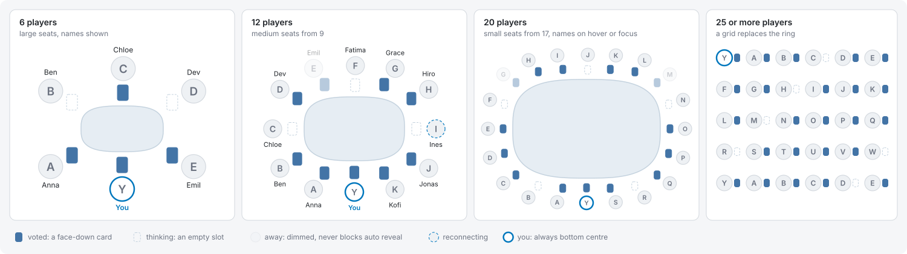
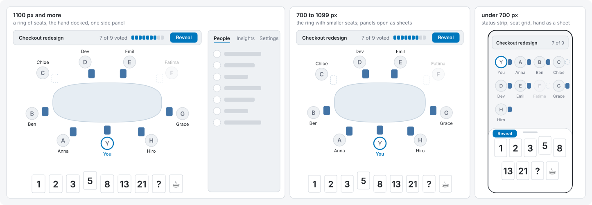
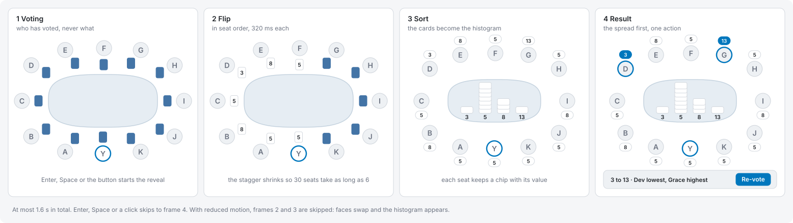

# v9 product and UX concept

What the rewritten product does and how it feels. The three figures are wireframes drawn from the planned seat geometry: they show structure and states, not the final look, which the table arena settles. `ARCHITECTURE.md` says how it is built and `PLAN.md` in which order; where they disagree with this file on behaviour, this file wins. Competitor facts and platform limits are from `research/r07-ux-competitive.md`, `r06-rendering-motion.md` and `r04-spa-stack.md`.

## Position

Free, no-signup planning poker is a crowded category: about ten new entrants in 24 months, most of them open source. "Free and no account" no longer sets a tool apart. What users complain about is caps (9 rounds, 7 or 10 participants), ads, paywalled basics and dated interfaces. v9 competes on five claims, each one checkable:

| Claim | How it is kept |
|-|-|
| From the landing page to a seat in under 10 seconds | one click, one name field, no account, no dialog wall |
| No cap on rounds or rooms, no ads | unlimited rounds and rooms, 30 players per room where free tiers elsewhere stop at 7 to 10, nothing paid |
| Nobody sees a vote before the reveal, not even in the network tab | the server withholds values until the reveal |
| No account, no cookie, no banner, and no name in any record | visits are counted by cookieless Umami; an anonymous device id counts the days you estimated and is never stored with a room or a vote. History knows seats by number, not by name |
| A reload, a sleeping phone or a deploy never costs you your seat or your vote | seat tokens, resume, handoff between server versions |

Beyond the five claims, the result view is where v9 differs in use. Estimation practice has moved from "what is the number" to "where do we disagree": the spread is the useful output, the average is not. v9's result view leads with the spread and names who should talk.

## Who uses it

- **A team of 3 to 9 in a refinement or planning meeting**, on a video call, each on a laptop. The main case; the table is designed for it.
- **A large group of 10 to 30**, a department or a workshop. The room must stay readable and nobody may wait on an absent seat.
- **Someone joining from a phone**, on the couch or in a meeting room without a laptop. Everything works; the layout is different.
- **The person who runs the meeting.** Shares the link, sets the topic, reveals, decides on a re-vote, wants a record at the end.

## Principles

1. **The table is the interface.** Who is here, who has voted and who everyone is waiting for are readable at a glance, without opening a panel.
2. **The spread is the product.** Results show agreement and outliers first.
3. **The fast path is never slower than v1.** Every animation is short and skippable, every action has a key.
4. **Play is optional and earned.** Celebration happens on consensus, not on every click. One switch turns the game feel off.
5. **Desktop first, phone complete.** No action is missing on a 360 px screen.
6. **Quiet by default.** Sound is off until the user turns it on; nothing loops; nothing moves while the user reads.

## The room

A room is a URL. Opening `/room/<slug>` seats you after you give a name; the same link is the invitation. A room has no owner. Every player may reveal, settle, move on, change settings, remove someone, lock the room and name it, as in v1, because small teams trust each other. Spectators watch and never block a reveal.

One thing is new and optional. A room can be **locked** with a password that someone types or lets the room generate. From then on the invite link carries it, so whoever has the link is in. Whoever has only the room's number is asked for the password once; everyone at the table can see it and read it out, and the device remembers it. It keeps strangers out and is no secret among colleagues, which the field says before anyone types a password they use elsewhere.

A room is reached by its **number**, and by a **name** if the team books one. "Start planning" draws a six-digit number, as in v1: it reads the same in every language and is quick to type on a phone. A team that comes back books a name, `team-alpha`, at any time; the number then forwards for 30 days. A number stays with its room for three months after the last visit, a booked name for six. After that the room still opens for whoever comes back, until the address is handed to a new room, and the room says in good time when a hold is about to end and offers to book a name.

What a team estimates is a **topic**: typed, pasted as a list, or left unnamed. A round is one attempt at it and has two states. **Voting:** players pick a card, can change it, and see only who has voted. **Revealed:** values are fixed and the result view is shown. From there the team settles the **final value**, votes again on the same topic, or moves on.

| Seat state | Shown as |
|-|-|
| thinking | avatar, empty card slot |
| voted | a face-down card slides into the slot |
| away (tab hidden 30 s) | dimmed; does not block auto reveal |
| reconnecting | outline pulse, after 3 s of lost connection |
| spectator | sits in the rail beside the table, no card slot |
| you | accent ring, always at the bottom centre |

Presence, vote and role combine: an away seat that has voted keeps its face-down card and is dimmed.

Avatars are generated from a random seed in a few shapes and token colours, re-rolled in settings. No uploads, no photos.

## Flows

**First visit.** Landing page → "Start planning" → the table appears with your seat already there and its name field focused, prefilled with a suggestion → Enter. That first click also copies the invite link where the browser allows it, and the centre of the empty table says so and shows the link and a QR code. No modal stands between the click and the table.

**Joining by link.** The table is visible behind a single name field. A returning visitor is seated at once with the stored name. Someone who joins mid-round sees who has voted and votes in that round.

**Inviting.** One button, always in the header. It copies the link at once and opens a small panel with the QR code for the people in the same room and, on a phone, the system's share sheet. In a locked room the link and the QR code include the password, and the panel shows it for reading aloud. While you are alone, the invitation is the centre of the table.

**A round.** The topic sits in the round bar and is editable in place. Players choose a card with a click, with the keys `1` to `9` and `0` for the first ten cards, or with the arrow keys and Enter for any card. The bar shows "7 of 9 voted" as a segmented meter. After 20 seconds it names who is missing, and any player can poke them. Reveal with the button or Enter; with auto reveal on, a three-second ring starts when the last active player votes, and any player can cancel it.

**Agreement.** When every card is the same, that value is the topic's final value at once, and the room celebrates. Nobody clicks anything.

**Disagreement.** The result says "Spread 3 to 13. Anna voted lowest, Ben highest." The distribution bar is also the decision: the card closest to the middle is marked as the suggestion, and a click on any bar settles the final value. The other action is a re-vote, which keeps the topic and clears the cards. The final value shows in the topic list and can be corrected there.

**A locked room.** With the full link there is nothing to do: the password is in it. With only the room's number or name, the table sits behind one field. A wrong password says so and nothing else; the room's display name and who is in it stay hidden until it is right. Any player locks, unlocks or changes the password in the room's settings and decides whether the people already seated stay. The device remembers the password with the room, so a bookmark without it opens the room without a question.

**A large room.** The table steps down to smaller seats and finally to a grid (rules under "Layout by size"). Spectators stay in the rail. Auto reveal ignores away seats, so one absent person never stalls 29.

**Coming back.** `/room` lists the rooms this device has visited, newest first, each with its name and, for an open room, how many people are in it right now. A room can be pinned to stay on top, or removed; an unpinned one drops off after six months without a visit. The same list opens from the room's header as a switcher, so moving between two teams' rooms is two clicks. The landing page shows the top three as "Back to …", which works because site and room share one origin. v1's jump from the home page into the last room is dropped: it surprised people who wanted the home page. If a remembered address has been handed to another room in the meantime, the device notices and says so before it seats you. The browser tab is titled with the room's name.

**Ending a session.** The summary lists every topic with its final value, spread, number of rounds and duration, with copy as Markdown and export as CSV. A topic without a final value shows its most common card, marked as open.

## Layout by size

The layout follows the width of the room container, by container queries, so the embedded variant gets the right layout too.

| Width | Table | Hand | Panels |
|-|-|-|-|
| 1100 px and more | ring of seats around a superellipse table | docked along the bottom, a shallow arc | one side panel: people, insights, settings |
| 700 to 1099 px | ring, smaller seats | docked | panels open as sheets |
| under 700 px | no ring: a status strip, then a seat grid of four or five columns | bottom sheet with two rows of large cards | full-screen sheets; the result is one |

Seat size steps down at 9 and at 17 players. The grid replaces the ring when the container is under 700 px wide or the room has 25 or more players. A Table/Grid switch overrides the automatic choice and replaces v1's "prefer card view".

Seats are spaced by arc length around the table edge, with the viewer always at the bottom centre. The geometry is therefore a pure function of seat count and container size, and it is tested without a browser.

## The reveal

The reveal is the only choreographed sequence. It takes at most 1.6 seconds:

1. Cards flip in seat order, 320 ms each, the stagger scaled so that 30 seats finish as fast as 6.
2. The cards leave their seats and sort into columns by value in the centre of the table. The histogram is made of the cards themselves; each seat keeps a small chip with its value.
3. The summary line appears: consensus, near consensus (only neighbouring cards), or split with the lowest and highest seat named. Median and most common value are shown; the average only for numeric decks, and smaller.
4. On consensus the cards gather into one stack, confetti fires once, the room's streak counts up.

Enter, Space or a click on the table skips to the end state. With reduced motion the cards swap faces without movement and the histogram simply appears. Distance between cards is measured in deck positions, so the rules work for T-shirt sizes as well as numbers.

## Motion, sound, touch

- **Motion** runs on transform and opacity, with durations and easings from basalt-ui's motion tokens: 150 ms and 250 ms today, a slow step and spring presets on the list for basalt-ui 3. Whether CSS alone carries the table or the `motion` library basalt-ui already depends on, the arena decides. Nothing animates in a loop.
- **Sound** is five short samples: card placed, reveal, consensus, poke, someone joined. Off for new users, one toggle, remembered on the device. Users who had sound on in v1 keep it.
- **Haptics** are a 10 ms tick on Android when a card lands. iOS offers none to web pages; nothing depends on it.
- **Reactions** are emoji thrown at a seat: an arc, a small bounce, gone. One every two seconds per person, never stored. The same mechanism carries the poke. A competitor's operator calls throwing things their most loved feature; it costs one ephemeral message type.

## Game feel without fatigue

A tool opened every day must not perform every day. The rules:

- Celebration happens only on consensus, once per round.
- Streaks ("4 in a row") are a small counter, never a popup.
- Round badges ("fastest round", "widest spread") appear in the session summary, not during play.
- **Calm mode**, per person, turns off reactions, confetti, sound and streaks. A room setting can disable reactions for everyone.

A personal record lives only on the device: rounds played, how often you matched the most common card, whether you tend to vote higher or lower than your teams. It is computed in the browser from what your own seat saw and is never sent anywhere.

## The table arena

The table's look is picked from competing entries, not designed once on paper. Several entries build the same table against the same harness, by different models and from different briefs, and the owner picks the pieces. The reason: the table decides whether the product feels like a round of cards or like a form, and no concept settles that in words.

**Fixed for every entry**

- **The contract.** An entry is one component. It takes a seat's view, the container's size and the person's preferences, and reports intents. It knows no socket and no store, so the same entry runs in the arena, in the room and on the landing page.
- **The scenarios.** The simulator plays one script for everyone, over these dimensions:

| Dimension | Values |
|-|-|
| Seats | 2, 5, 9, 16, 30 |
| Phase | voting, countdown, unanimous reveal, split reveal, second vote, settled |
| People | someone away, someone reconnecting, spectators |
| Container | a 360 px phone, a laptop, a wall screen |
| Preferences | light and dark, reduced motion on and off |

- **The floor**, each line with what it protects:

| Rule | Protects |
|-|-|
| Seats and cards are real elements in reading order | screen readers, the keyboard, and text that stays sharp at any zoom |
| Everything can be done from the keyboard | people who never touch the mouse in a meeting |
| With reduced motion the reveal shows its end state at once | people who set that preference |
| At 30 seats the reveal keeps a median frame under 20 ms in Chrome with the CPU slowed four times | a phone in a large room |
| At most 60 kB gzip of the entry's own code | the room's load time |
| Colours and type come from basalt-ui's tokens | light and dark, and one look across table and chrome |

**Free for every entry:** everything else. The shape of the table, the cards, how a card travels, what the reveal does with them, light, depth, sound, haptics, a canvas layer under the elements. The sections "Layout by size" and "The reveal" describe the starting point, not a rule. An entry may replace either, as long as the result still leads with the spread and the reveal ends within 1.6 seconds. Each entry names its direction in one line ("a felt table under a lamp", "paper and ink", "arcade"), so the entries explore the space and do not converge.

**Judging.** The arena runs on the beta host, so it opens on any device. It shows two entries side by side on the same scenario, in step. A scorecard per entry holds what a machine can measure: frame times during the reveal, bytes, accessibility findings, screenshots of every scenario, a recording of the reveal. The rest is judged by the owner. Does it feel like a round of cards? Does it read at 30 seats? Does it hold on a phone? The pick may take the table from one entry and the reveal from another; the row `v9-table-pick` then builds `packages/table` from the pieces.

**Who enters, and where it runs.** The factory builds the arena itself: the contract, the scenarios, the gallery and the scorecard are ordinary engineering. The entries are not factory work. They are made in sessions the owner starts when the room's interface foundation stands: several directions, several models from several labs through his launchers, as many rounds as the result needs. The brief is one file, the harness one command, an entry one directory and one pull request, so any coding agent can enter without knowing the rest of the repository.

## Decks and facilitation

- **Decks** are data: Fibonacci (default, as v1), modified Fibonacci, T-shirt, powers of two, and custom values; `?` (abstain) and a break card are available in each. Every card carries a number behind its label, and T-shirt sizes map onto the Fibonacci numbers, so history and statistics compare across decks.
- **Topics.** Type a topic, paste a list, one per line, or drop a tracker's CSV export. A line that starts with a ticket key ("SHOP-123 Checkout redesign") or is a tracker link keeps that reference, so the result can find its way back later. The queue feeds the round bar, survives the weekend, and holds up to 200 topics.
- **Timer.** Optional countdown of 30, 60 or 120 seconds as a ring on the round bar. When it runs out with auto reveal off, nothing happens. With auto reveal on, it starts the same cancellable three-second ring as the last vote does.

Not at launch, in the order they are likely to come:

- webhooks that send each result to an address a player sets, including Slack and Teams, with recipes for Zapier, Make and n8n
- a route that lets a script or an automation fill a room's queue
- a Jira app that frames the room on an issue or a board and writes the story points back
- a Teams tab; Zoom and Meet when asked for
- further activities in the room, under "More than poker"
- asynchronous rounds
- languages beyond English and German
- an AI seat
- the owner's silent observer seat for support, which needs a line in the privacy page before it exists

None of these changes a table or the protocol when it arrives: the topic already carries its tracker reference, every result already leaves the room in one shape, and every command already names its activity (`ARCHITECTURE.md`, "Built for what comes next").

## More than poker

The room is built to host other things a team decides together. What belongs to the room stays: the link, the people, the roles, the lock, the topic queue. An activity is what the table shows at the moment.

| Activity | What it is | Why it fits |
|-|-|-|
| Confidence vote | everyone shows 0 to 5 at once ("fist of five") | it is a round with one small deck |
| Dot voting | each person spends a few dots on the topics in the queue | it ranks the queue the team then estimates |
| Wheel | picks who speaks first, or the order of a stand-up | the server spins, so every screen shows the same result |
| Timer | a shared countdown | it is already in the round bar |

The likely order is confidence vote, dot voting, wheel. Each of the three gets a page on the site that opens a room with that activity chosen. They are reasons to stay, not ways to be found: "planning poker" is searched about 33,000 times a month, each of these under 4,400 (`research/r23-team-activities.md`).

Retrospective boards are not on the list. They need anonymous free text, grouping and columns, which is a different model and a crowded market of its own.

## Insights

- **In the room:** rounds per session, share of rounds with consensus, typical spread, time to reveal, how often each card wins. Built from basalt-ui's chart kinds: bars, lines, a weekday-by-hour heatmap, sparklines in stat cards.
- **Public statistics page** at `/analytics`, as today but honest: totals, rounds per week, card popularity, consensus rate, when the world estimates, tables open right now. v1 shows invented fallback numbers when its database is down; v9 shows the last known figures with their date.

## Phone, install, embed

- **Phone.** The layout is the under-700 px row above. Every card is reachable with one thumb, and names in the seat grid wrap rather than truncate. The socket drops when the browser is backgrounded; coming back restores the seat without a prompt.
- **Install.** The room app is a PWA. The offer to install sits in the room's menu and appears once as a quiet hint on the second visit. From the home screen it opens `/room` with the recent rooms, in its own window. Offline it shows the shell and the recent rooms and says so; it never queues a vote. A new version is offered between rounds, never during one.
- **Embed.** Any page can frame a room. `?embed=1` drops the site chrome and the layout follows the frame's size, down to a narrow side panel. Room settings show the snippet to copy. The embedding page can do more than show the room: it can set the person's name and theme, hand over the topics and receive each result, so a host writes the estimate into its own ticket. That is how the room gets into Jira, Teams, Zoom, Meet or Trello after launch: a small app around the same frame. Inside a frame the browser keeps storage apart, and Safari forgets it between launches, so a returning person may be asked for the name again and gets the old seat back by giving it.

## Accessibility

Seats are a list in DOM order with arrow-key movement; the ring is presentation. A live region announces progress ("7 of 9 voted") and the result, never anything that would hint at a vote before the reveal. A voted seat is marked by shape, not colour alone. Every action has a key, listed in the command palette (`Cmd+K`). Contrast comes from basalt-ui's derived tokens. Reduced motion is honoured by the system setting and by calm mode.

## Copy

Product copy follows the `broad` register of the voice guide:

- Labels are verb plus object: "Copy invite link", "Reveal cards", "Start new round".
- An error says what happened and what to do.
- An empty state points at the first action.
- One word per thing everywhere: room, seat, round, card, reveal, topic.

## Languages

The room speaks its visitor's language from the first release: English and German in 9.0.0, further languages as someone who speaks them has reviewed them.

- The language is each person's own. It follows the browser on the first visit and a switch in the settings afterwards, and a room link never carries it, so a mixed team shares one link.
- Nothing a person reads is written into a component. Counts, dates and numbers follow the language's rules, and the layout holds German's longer labels and a right-to-left script.
- Room numbers and generated passwords use digits and Latin letters only, so they can be read out in any language.
- The site launches in English. A second language appears there only when every page of it is translated and reviewed: half a translated site reads worse than none.
- Translations are files in the repository. A model drafts them and a native speaker reviews them before they ship.

## The marketing site

Static pages whose only JavaScript is the 4 kB analytics script, plus islands that load when they scroll into view. Light and dark follow the system and can be switched, on the site and in the room.

**The landing page**, top to bottom:

1. **The hero is the product.** A live table played by scripted participants, with three ways in beside it: "Start planning" (one click, you are seated and the invite link is copied), "Join a room" (paste a link or type its number or name) and, on a device that has been here, "Back to …" with its last rooms.
2. **The five claims**, each with the one fact that backs it.
3. **A bento grid of features, every tile the real thing.** The reveal turning cards into the spread, a hand of each deck, a table growing from 3 to 30 seats, the insights of a seeded room, a locked room's invite, the room inside a ticket. The tiles run the product's own components on the simulator. No video and no screenshot that goes stale.
4. **How a round works**, in four steps.
5. **Open source and self-hosting:** the licence, the repository, one compose file.
6. **Questions**, answered on the page in full sentences.

| Page | Job |
|-|-|
| `/` | the landing page above |
| `/guide` and `/guides/*` | the pillar: planning poker and story points explained, then one page per practice: decks, when a spread means split the story, running a large room |
| `/glossary/*` | one short page per term a team looks up |
| `/vs/*` | honest comparison pages, each fact dated and sourced |
| `/data` | once a year, what a year of anonymous rounds shows: how often teams agree, which cards win, how long a round takes. Figures from the product's own rounds |
| `/analytics` | public statistics, live |
| `/blog` | articles from a content collection |
| `/docs` | every feature explained for users, with a static search; the contributor's overview stays in the repository |
| `/roadmap` | changelog from releases, and what is next; replaces the Todoist-backed page |
| `/self-hosting` | one compose file |
| `/privacy`, `/imprint`, `/contact` | what is measured and how, in plain words; the imprint as it stands |

Every existing URL keeps its path. Each page gets its own title, description, canonical link, social image and structured data, none of which v1 has. Room pages stay out of every index.

### Being found

By search engines, and by the assistants people now ask instead. What the evidence says, heaviest first (`research/r20-ai-search-visibility.md`):

| What counts | Evidence | What we do |
|-|-|-|
| Others mention the product | the strongest measured signal, as a correlation and not a proven cause. Across 75,000 brands, mentions on YouTube (0.74) and on other sites (about 0.7) track being named by an assistant; a site's own page count barely does (0.19) | a demo video, listings in tool directories and curated lists, real answers where teams ask. This part is the owner's, and on this evidence the one most likely to matter |
| The text is in the HTML | the crawlers of ChatGPT, Claude and Perplexity ran no JavaScript when last measured | Astro renders every word at build time |
| The crawlers are let in | Cloudflare blocks AI crawlers by default on new zones; search, user-triggered and training bots are separate | an explicit `robots.txt` that allows all three kinds, and the zone's bot settings checked at launch. A model trained on pages about the product can name it without searching |
| Something worth citing | dated, sourced claims and original figures are what gets quoted | `/data`, the live statistics, comparison pages with dates and sources |
| One topic, covered properly | practitioner consensus, thin evidence | one pillar guide with cluster pages and a glossary, written by a person, with the product's own numbers. No generated page farms: Google's policy on scaled content names them |
| Structured data | a cheap baseline with no measured effect on assistants. FAQ markup no longer produces a rich result in Google (ended 2026-05-07), but it costs one component and other engines and parsers may still read it | Organization, WebSite, SoftwareApplication, Article, BreadcrumbList, and FAQPage on the pages that hold questions. The questions and answers are on the page as text first; the markup repeats them |
| Speed | the thresholds stand: LCP 2.5 s, INP 200 ms, CLS 0.1 | static pages, islands on visibility, budgets in CI |
| Bing | its index feeds Copilot, and IndexNow tells it about changes | Bing Webmaster Tools and an IndexNow ping on deploy |
| `llms.txt` and Markdown twins | 97 % of published files were not fetched once in a month; no assistant is shown to read them | one generated `llms.txt` and a `.md` twin per content page, because they cost one build step. Nothing depends on them |

The repository's README is a landing page too. It says what the product is in one sentence and shows a recording of a round, then the live link, the five claims, self-hosting in one command and the licence. It is rewritten for 9.0.0.

Visibility is measured with what is free: Search Console, Bing's AI performance report, referrers from assistant domains in Umami, and Cloudflare's view of which crawlers came.

## What changes for a v1 user

| v1 | v9 |
|-|-|
| Room by name in the URL | unchanged |
| Fibonacci 1 to 21 only | default deck, plus three more and custom, with `?` to abstain |
| A round ends at the reveal | the team settles a final value, kept per topic |
| Anyone with the link gets in | unchanged by default; a room can be locked with a code that travels in the link |
| No owner of a room | unchanged: every player runs the room, including its lock and its name |
| A new room is a six-digit number | unchanged. A custom name is now a booking, and numbers and names nobody uses return to the pool |
| A room keeps its number and its name for ever | a number is released three months after the last visit, a booked name after six. A released one still opens until it is handed to a new room |
| "Show votes" only when everyone has voted | reveal any time after the first vote, with a confirmation when seats are still thinking |
| Auto flip exists on the server without a switch | a setting, with a cancellable countdown |
| Spectator, kick, leave, rename | unchanged |
| Table or card view | Table or Grid, chosen automatically by size, switchable |
| Elapsed-time counter | kept, plus the optional countdown |
| Four sounds, on by default | five sounds, off for new users |
| Confetti on a unanimous vote | kept, joined by the streak counter |
| Room statistics in the sidebar | the Insights panel |
| Home page jumps into the last room | recent rooms at `/room`, on the landing page and as a switcher in the room |
| Name and settings in localStorage | read once and kept |
| Feedback form | unchanged |
